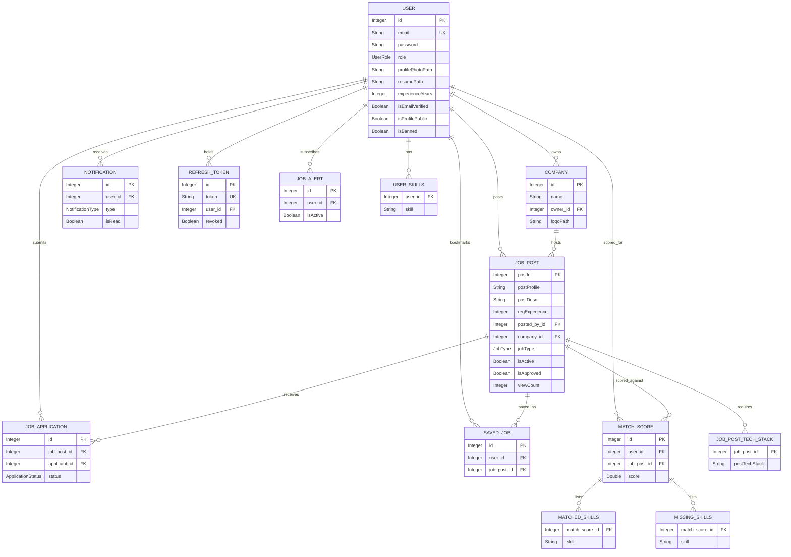
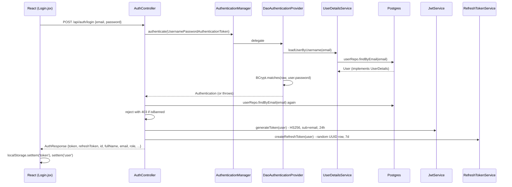
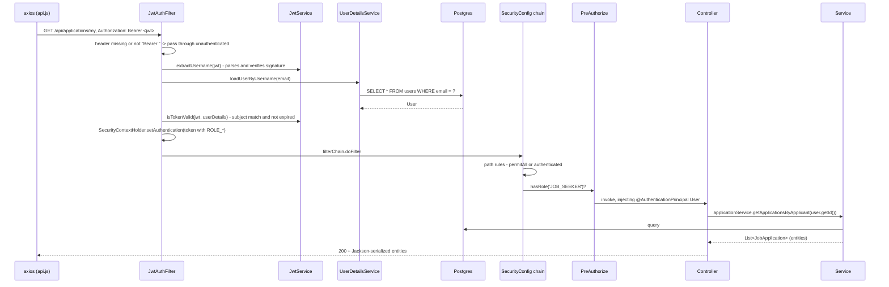

# Architecture

**Subject:** `com.tausib.springjobportal` — Spring Boot 3.4.3, Java 21, PostgreSQL, React 19 (Vite)
**Status:** Description of the code as it exists. No source file was modified to produce this document.
**Date:** 2026-08-28

Scope note: this describes the current working tree, which already has direct messaging and the
admin dashboard removed. Where the README or `CLAUDE.md` still describe those features, or describe
WebSockets, they are describing code that is no longer present.

---

## 1. Package layout

```
com.tausib.springjobportal
├── SpringJobPortalApplication      @SpringBootApplication @EnableAsync
├── aop/          LoggingAspect, PerformanceMoniterAspect, ValidationAspect
├── config/       ApplicationConfig, JwtService, JwtAuthFilter, SecurityConfig, SwaggerConfig
├── controller/   AI, Auth, Company, Dashboard, File, JobApplication, JobRest, Notification, User
├── dto/          8 request/response shapes (auth, company, search, profile, dashboard)
├── exception/    GlobalExceptionHandler, ResourceNotFoundException
├── model/        9 entities + 4 enums
├── repo/         9 Spring Data JPA interfaces
└── service/      AI, Company, Email, FileStorage, JobApplication, Job, Notification,
                  RefreshToken, User
```

The React frontend lives at `src/main/frontend/` — inside the Maven source tree but not a Maven
module. It is joined to the backend only by the Docker build.

---

## 2. Entities

Schema is generated by `spring.jpa.hibernate.ddl-auto=update`. There are no migration files, so the
entity classes below *are* the schema definition.

### `User` → table `users`

Implements `org.springframework.security.core.userdetails.UserDetails`.

| Field | Type | Column notes |
|---|---|---|
| `id` | `Integer` | `@Id`, `IDENTITY` |
| `fullName` | `String` | |
| `email` | `String` | `unique`, `not null` — also serves as `getUsername()` |
| `password` | `String` | `not null`, `@JsonIgnore`, BCrypt hash |
| `role` | `UserRole` | `@Enumerated(STRING)`, `not null` |
| `phone` | `String` | |
| `bio` | `String` | `TEXT` |
| `location` | `String` | |
| `profilePhotoPath` | `String` | relative path inside the upload dir |
| `resumePath` | `String` | relative path inside the upload dir |
| `skills` | `List<String>` | `@ElementCollection(EAGER)` → table `user_skills(user_id, skill)` |
| `experienceYears` | `Integer` | |
| `currentJobTitle` | `String` | |
| `linkedinUrl` / `githubUrl` / `portfolioUrl` | `String` | |
| `isEmailVerified` | `Boolean` | default `false` |
| `emailVerificationToken` | `String` | `@JsonIgnore` |
| `passwordResetToken` | `String` | `@JsonIgnore` |
| `passwordResetExpiry` | `LocalDateTime` | `@JsonIgnore` |
| `isProfilePublic` | `Boolean` | default `true` |
| `isBanned` | `Boolean` | default `false`; drives `isAccountNonLocked()` |
| `createdAt` | `LocalDateTime` | `@CreationTimestamp` |
| `updatedAt` | `LocalDateTime` | `@UpdateTimestamp` |

`UserDetails` methods: `getAuthorities()` returns a single `ROLE_<role>`; `isAccountNonExpired`,
`isCredentialsNonExpired`, `isEnabled` are hardcoded `true`; `isAccountNonLocked` is `!isBanned`.

**Relationships (inverse side only — `User` owns no collections):** referenced by `Company.owner`,
`JobPost.postedBy`, `JobApplication.applicant`, `SavedJob.user`, `Notification.user`,
`MatchScore.user`, `RefreshToken.user`, `JobAlert.user`.

### `Company` → `companies`

| Field | Type | Notes |
|---|---|---|
| `id` | `Integer` | `@Id`, `IDENTITY` |
| `name` | `String` | `not null` |
| `description` | `String` | `TEXT` |
| `website`, `location`, `industry`, `size`, `logoPath` | `String` | |
| `owner` | `User` | `@ManyToOne(EAGER)` → `owner_id`, `not null` |
| `createdAt` | `LocalDateTime` | `@CreationTimestamp` |

### `JobPost` → `job_post` (default naming; no `@Table`)

| Field | Type | Notes |
|---|---|---|
| `postId` | `Integer` | `@Id`, `IDENTITY` |
| `postProfile` | `String` | the job title |
| `postDesc` | `String` | `TEXT` |
| `reqExperience` | `Integer` | |
| `postTechStack` | `List<String>` | `@ElementCollection(EAGER)`, default-named collection table |
| `postedBy` | `User` | `@ManyToOne(EAGER)` → `posted_by_id`, **nullable** |
| `company` | `Company` | `@ManyToOne(EAGER)` → `company_id`, nullable |
| `salaryMin` / `salaryMax` | `BigDecimal` | |
| `location` | `String` | |
| `jobType` | `JobType` | `@Enumerated(STRING)`, default `FULL_TIME` |
| `isRemote` | `Boolean` | default `false` |
| `isActive` | `Boolean` | default `true` |
| `isFeatured` | `Boolean` | default `false` |
| `isApproved` | `Boolean` | default `true` |
| `applicationDeadline` | `LocalDate` | never read anywhere |
| `viewCount` | `Integer` | default `0`, incremented on every `getJob` |
| `postedDate` | `LocalDateTime` | `@CreationTimestamp` |

### `JobApplication` → `job_applications`

| Field | Type | Notes |
|---|---|---|
| `id` | `Integer` | `@Id`, `IDENTITY` |
| `jobPost` | `JobPost` | `@ManyToOne(EAGER)` → `job_post_id`, `not null` |
| `applicant` | `User` | `@ManyToOne(EAGER)` → `applicant_id`, `not null` |
| `coverLetter` | `String` | `TEXT` |
| `status` | `ApplicationStatus` | `@Enumerated(STRING)`, `not null`, default `PENDING` |
| `appliedDate` | `LocalDateTime` | `@CreationTimestamp` |

No unique constraint on `(job_post_id, applicant_id)` — duplicate applications are prevented only in
service code.

### `SavedJob` → `saved_jobs`

| Field | Type | Notes |
|---|---|---|
| `id` | `Integer` | `@Id`, `IDENTITY` |
| `user` | `User` | `@ManyToOne(LAZY)` → `user_id`, `not null` |
| `jobPost` | `JobPost` | `@ManyToOne(EAGER)` → `job_post_id`, `not null` |
| `savedAt` | `LocalDateTime` | `@CreationTimestamp` |

`@UniqueConstraint(columnNames = {"user_id", "job_post_id"})`.

### `Notification` → `notifications`

| Field | Type | Notes |
|---|---|---|
| `id` | `Integer` | `@Id`, `IDENTITY` |
| `user` | `User` | `@ManyToOne(LAZY)` → `user_id`, `not null` |
| `title` | `String` | `not null` |
| `message` | `String` | `TEXT` |
| `type` | `NotificationType` | `@Enumerated(STRING)`, `not null` |
| `actionUrl` | `String` | frontend route, e.g. `/my-applications` |
| `isRead` | `Boolean` | default `false` |
| `createdAt` | `LocalDateTime` | `@CreationTimestamp` |

### `MatchScore` → `match_scores`

Cache table for `AIService` results.

| Field | Type | Notes |
|---|---|---|
| `id` | `Integer` | `@Id`, `IDENTITY` |
| `user` | `User` | `@ManyToOne(LAZY)` → `user_id`, `not null` |
| `jobPost` | `JobPost` | `@ManyToOne(LAZY)` → `job_post_id`, `not null` |
| `score` | `Double` | `not null`, 0.0–100.0 |
| `matchedSkills` | `List<String>` | `@ElementCollection(EAGER)` → `matched_skills(match_score_id, skill)` |
| `missingSkills` | `List<String>` | `@ElementCollection(EAGER)` → `missing_skills(match_score_id, skill)` |
| `generatedAt` | `LocalDateTime` | `@CreationTimestamp` |

No unique constraint on `(user_id, job_post_id)` despite being used as a cache key.

### `RefreshToken` → `refresh_tokens`

| Field | Type | Notes |
|---|---|---|
| `id` | `Integer` | `@Id`, `IDENTITY` |
| `token` | `String` | `unique`, `not null`, a random UUID (not a JWT) |
| `user` | `User` | `@ManyToOne(LAZY)` → `user_id`, `not null` |
| `expiryDate` | `LocalDateTime` | `not null` |
| `revoked` | `Boolean` | default `false` |

### `JobAlert` → `job_alerts`

Persisted and mapped, but **no service, controller, or repository call touches it**. See §9.6.

| Field | Type | Notes |
|---|---|---|
| `id` | `Integer` | `@Id`, `IDENTITY` |
| `user` | `User` | `@ManyToOne(LAZY)` → `user_id`, `not null` |
| `keywords`, `location` | `String` | |
| `jobType` | `JobType` | `@Enumerated(STRING)` |
| `minExperience`, `maxExperience` | `Integer` | |
| `isActive` | `Boolean` | default `true` |
| `createdAt` | `LocalDateTime` | `@CreationTimestamp` |

### Enums

- `UserRole` — `EMPLOYER`, `JOB_SEEKER`, `ADMIN`
- `JobType` — `FULL_TIME`, `PART_TIME`, `CONTRACT`, `INTERNSHIP`, `FREELANCE`
- `ApplicationStatus` — `PENDING`, `REVIEWED`, `ACCEPTED`, `REJECTED`
- `NotificationType` — `APPLICATION_RECEIVED`, `APPLICATION_STATUS_CHANGED`, `JOB_ALERT`,
  `PROFILE_VIEWED`, `SYSTEM_ANNOUNCEMENT`

---

## 3. Entity-relationship diagram



---

## 4. REST endpoints

Two authorization layers apply and both matter: coarse path rules in `SecurityConfig`, and
per-method `@PreAuthorize` (method security is enabled). "Auth" below is the effective requirement.

Because most endpoints return JPA entities directly, the response shape is the entity's JSON
projection as filtered by `@JsonIgnore` / `@JsonIgnoreProperties`.

### `AuthController` — `/api/auth` (all public)

| Method | Path | Auth | Request | Response |
|---|---|---|---|---|
| POST | `/register` | public | `RegisterRequest` `{fullName, email, password, role}` (`@Valid`) | `AuthResponse` `{token, refreshToken, id, fullName, email, role}`; `400 {error}` if email taken |
| POST | `/login` | public | `AuthRequest` `{email, password}` (`@Valid`) | `AuthResponse` + `{profilePhotoPath, skills}`; `403 {error}` if banned |
| POST | `/refresh-token` | public | `Map` `{refreshToken}` | `{token, refreshToken}` |
| POST | `/verify-email` | public | `Map` `{token}` | `{message}` or `400 {error}` |
| POST | `/forgot-password` | public | `PasswordResetRequest` `{email}` (`@Valid`) | `{message}` (always identical, by design) |
| POST | `/reset-password` | public | `NewPasswordRequest` `{token, newPassword}` (`@Valid`) | `{message}` or `400 {error}` |

### `JobRestController` — `/api/jobs`

`SecurityConfig` permits **all** `GET /api/jobs/**` without authentication.

| Method | Path | Auth | Request | Response |
|---|---|---|---|---|
| GET | `` | public | — | `List<JobPost>` (every job, no filter, no paging) |
| GET | `/paginated` | public | `?page=0&size=10` | `Page<JobPost>` (active only) |
| GET | `/search` | public | `?keyword&location&jobType&isRemote&minExp&maxExp&page&size&sortBy&sortDir` | `Page<JobPost>` |
| GET | `/{postId}` | public | — | `JobPost`; **side effect: increments `viewCount`** |
| GET | `/keyword/{keyword}` | public | — | `List<JobPost>` (case-sensitive `LIKE`) |
| GET | `/featured` | public | — | `List<JobPost>` |
| GET | `/my` | `EMPLOYER` | `@AuthenticationPrincipal` | `List<JobPost>` |
| GET | `/saved` | **effectively public** — see §9.6 | — | `List<SavedJob>` |
| GET | `/{postId}/is-saved` | **effectively public** — see §9.6 | — | `{saved: boolean}` |
| GET | `/load` | public | — | `"success"` (no-op) |
| POST | `` | `EMPLOYER` | `JobPost` **entity** as body | `JobPost` |
| PUT | `/{postId}` | `EMPLOYER` | `JobPost` **entity** as body | `JobPost` |
| DELETE | `/{postId}` | `EMPLOYER` | — | `{message}` |
| POST | `/{postId}/save` | authenticated | — | `SavedJob` |
| DELETE | `/{postId}/save` | authenticated | — | `{message}` |

`GET /saved` and `GET /{postId}/is-saved` are the important rows: they carry no `@PreAuthorize`
and match the blanket `GET /api/jobs/**` permit rule, so Spring never populates a principal for an
anonymous caller. `GET /my` is not affected — its `@PreAuthorize("hasRole('EMPLOYER')")` holds.

### `JobApplicationController` — `/api/applications`

| Method | Path | Auth | Request | Response |
|---|---|---|---|---|
| POST | `/job/{jobId}` | `JOB_SEEKER` | `Map` `{coverLetter}` | `JobApplication` |
| GET | `/my` | `JOB_SEEKER` | — | `List<JobApplication>` |
| GET | `/job/{jobId}` | `EMPLOYER` | — | `List<JobApplication>` — **any** employer, not just the owner |
| PATCH | `/{id}/status` | `EMPLOYER` | `Map` `{status}` | `JobApplication` — **any** employer |

### `CompanyController` — `/api/companies`

`SecurityConfig` permits all `GET /api/companies/**`.

| Method | Path | Auth | Request | Response |
|---|---|---|---|---|
| POST | `` | `EMPLOYER` | `CompanyRequest` (`@Valid`) | `Company` |
| PUT | `/{id}` | `EMPLOYER` + ownership checked in service | `CompanyRequest` (not `@Valid`) | `Company` |
| GET | `/{id}` | public | — | `Company` (includes owner sub-object) |
| GET | `` | public | — | `List<Company>` |
| GET | `/my` | `EMPLOYER` | — | `List<Company>` |
| POST | `/{id}/logo` | `EMPLOYER`, **no ownership check** | multipart `file` | `{path}` |
| DELETE | `/{id}` | `EMPLOYER` + ownership checked in service | — | `{message}` |

### `UserController` — `/api/users` (all authenticated; no role restriction)

| Method | Path | Auth | Request | Response |
|---|---|---|---|---|
| GET | `/me` | authenticated | — | `User` |
| GET | `/{id}` | authenticated | — | `User`, or `404` if `isProfilePublic` is false |
| PUT | `/me` | authenticated | `ProfileUpdateRequest` (not `@Valid`) | `User` |
| POST | `/me/photo` | authenticated | multipart `file` | `{path, message}` |
| POST | `/me/resume` | authenticated | multipart `file` | `{path, message}` |
| PATCH | `/me/visibility` | authenticated | `Map` `{isPublic}` | `{isProfilePublic}` — **never persisted**, see §9.6 |

### `NotificationController` — `/api/notifications` (all authenticated)

| Method | Path | Auth | Request | Response |
|---|---|---|---|---|
| GET | `` | authenticated | — | `List<Notification>` |
| GET | `/unread` | authenticated | — | `List<Notification>` |
| GET | `/unread-count` | authenticated | — | `{count}` |
| PATCH | `/{id}/read` | authenticated, **no ownership check** | — | `Notification` |
| POST | `/mark-all-read` | authenticated | — | `{message}` |
| DELETE | `/{id}` | authenticated, **no ownership check** | — | `{message}` |

### `AIController` — `/api/ai`

| Method | Path | Auth | Request | Response |
|---|---|---|---|---|
| GET | `/match-score/{jobId}` | `JOB_SEEKER` | — | `MatchScore` |
| GET | `/salary-estimate` | `JOB_SEEKER` | — | `{estimatedMinSalary, estimatedMaxSalary, currency, experienceYears, skillCount, highDemandSkills}` |
| GET | `/recommended-jobs` | `JOB_SEEKER` | `?threshold=50` | `List<MatchScore>` |
| POST | `/auto-apply` | `JOB_SEEKER` | `?threshold=70` | `{matchesFound, applicationsSubmitted, threshold}` |

### `DashboardController` — `/api/dashboard` (class-level `@PreAuthorize("hasRole('EMPLOYER')")`)

| Method | Path | Auth | Request | Response |
|---|---|---|---|---|
| GET | `/employer` | `EMPLOYER` | — | `DashboardStats` `{totalJobs, totalApplications, totalViews, applicationsByStatus, jobsByMonth}` |

`jobsByMonth` is declared on the DTO and never populated — it always serializes as `null`.

### `FileController` — `/api/files` (permitted for everyone in `SecurityConfig`)

| Method | Path | Auth | Request | Response |
|---|---|---|---|---|
| GET | `` | **public** | `?path=<relative path>` | raw bytes, `Content-Type` guessed from extension, `Content-Disposition: inline` |

---

## 5. Services and their dependencies

```mermaid
graph TD
    AuthC[AuthController] --> UserRepo
    AuthC --> JwtService
    AuthC --> RefreshTokenService
    AuthC --> UserService
    AuthC --> AuthenticationManager

    AIC[AIController] --> AIService
    AIC --> JobService
    AIC --> JobApplicationService
    DashC[DashboardController] --> JobService
    DashC --> JobApplicationService
    DashC --> JobRepo
    CompC[CompanyController] --> CompanyService
    CompC --> FileStorageService
    UserC[UserController] --> UserService
    UserC --> FileStorageService
    AppC[JobApplicationController] --> JobApplicationService
    JobC[JobRestController] --> JobService
    NotifC[NotificationController] --> NotificationService
    FileC[FileController] --> FileStorageService

    JobApplicationService --> JobApplicationRepo
    JobApplicationService --> JobRepo
    JobApplicationService --> UserRepo
    JobApplicationService --> NotificationService
    JobApplicationService --> EmailService
    UserService --> UserRepo
    UserService --> PasswordEncoder
    UserService --> EmailService
    JobService --> JobRepo
    JobService --> SavedJobRepo
    CompanyService --> CompanyRepo
    NotificationService --> NotificationRepo
    AIService --> MatchScoreRepo
    RefreshTokenService --> RefreshTokenRepo
    EmailService --> JavaMailSender
```



| Service | Depends on | Responsibility |
|---|---|---|
| `UserService` | `UserRepo`, `PasswordEncoder`, `EmailService` | profile read/update, photo & resume path updates, email-verification tokens, password-reset tokens |
| `JobService` | `JobRepo`, `SavedJobRepo` | job CRUD, paging, search, featured jobs, **and** saved-job bookmarks |
| `JobApplicationService` | `JobApplicationRepo`, `JobRepo`, `UserRepo`, `NotificationService`, `EmailService` | apply, list, status transition, counts, employer status breakdown |
| `CompanyService` | `CompanyRepo` | company CRUD with inline ownership checks |
| `NotificationService` | `NotificationRepo` | create / list / mark-read / delete |
| `AIService` | `MatchScoreRepo` | rule-based skill match scoring, salary estimation, recommendation ranking |
| `EmailService` | `JavaMailSender` | four `@Async` templated plaintext emails; swallows all send failures |
| `FileStorageService` | none (constructor takes `@Value("${app.upload.dir:./uploads}")`) | validate, store, load, delete uploads |
| `RefreshTokenService` | `RefreshTokenRepo` | issue, verify, revoke refresh tokens |

All services use constructor injection via Lombok `@RequiredArgsConstructor`. There is no `@Autowired`
on any field anywhere in the codebase.

**Transactions:** only two methods carry `@Transactional` — `JobService.unsaveJob` and
`RefreshTokenService.revokeAllUserTokens`. Nothing else, including every multi-write operation, has
an explicit boundary. See §9.6.

### AOP layer

Three aspects in `aop/` weave into **both** `controller..*` and `service..*`:

- `LoggingAspect` — `@Before` / `@After` / `@AfterReturning` / `@AfterThrowing`. `@AfterReturning`
  logs the entire returned object at INFO, so every `User` and `JobApplication` returned by any layer
  is written to the log in `toString()` form.
- `PerformanceMoniterAspect` — `@Around`, logs elapsed ms.
- `ValidationAspect` — `@Around` on `JobService.updateJob(..) && args(postid)`, intended to flip a
  negative `postid` to its absolute value. The pointcut binds a single `int` argument but the real
  signature is `updateJob(JobPost)`, so the advice never matches and the rewrite never fires.

---

## 6. Auth flow, end to end

### Registration / login → token



Key details:

- `User` *is* the `UserDetails`, so the whole JPA entity becomes the security principal.
- The JWT is signed HS256 with `jwt.secret`, base64-decoded via `Decoders.BASE64`. Subject is the
  email. Expiry `jwt.expiration` = 86 400 000 ms (24 h). **No role claim is embedded** — authorities
  are re-read from the database on every request.
- The refresh token is a plain UUID row in `refresh_tokens`, not a JWT.
- Note the double lookup: the `AuthenticationProvider` loads the user, then `AuthController` loads it
  again by email.

### Protected request → data



Failure paths:

- Any exception inside `JwtAuthFilter` (expired, bad signature, malformed) is caught, printed to
  `System.err`, and the chain continues **unauthenticated** — so the request then fails at the
  authorization layer as 401/403 rather than surfacing the parse error.
- The frontend's axios response interceptor treats **any** 401 as logout: it clears `localStorage`
  and hard-redirects to `/login`, so a single failing authenticated call signs the user out rather
  than surfacing an error.
- `revokeAllUserTokens` exists but is never called, and `JwtAuthFilter` never consults the `revoked`
  flag, so an issued JWT stays valid for its full 24 h regardless of any revocation.

---

## 7. File upload and retrieval

### Storage

`FileStorageService` resolves `app.upload.dir` (default `./uploads`) to an absolute normalized path
at construction and creates `photos/`, `resumes/`, `logos/` beneath it.

Three entry points, structurally identical:

| Method | Subdir | Allowed extensions | Stored filename |
|---|---|---|---|
| `storeProfilePhoto(file, userId)` | `photos` | jpg, jpeg, png, gif, webp | `photo_<userId>_<8 hex>.<ext>` |
| `storeResume(file, userId)` | `resumes` | pdf, doc, docx | `resume_<userId>_<8 hex>.<ext>` |
| `storeCompanyLogo(file, companyId)` | `logos` | jpg, jpeg, png, gif, webp | `logo_<companyId>_<8 hex>.<ext>` |

`validateFile` rejects empty files, files over 10 MB, and extensions outside the allowlist. The
extension check reads the **client-supplied filename only** — there is no content sniffing and no
declared-MIME check. `spring.servlet.multipart.max-file-size` is also 10 MB, so the framework rejects
oversized uploads before the service sees them.

Each `store*` returns a relative path such as `resumes/resume_4_a1b2c3d4.pdf`. The controller then
calls a **separate** service method (`userService.updateResumePath`, `companyService.updateLogoPath`)
to persist that string on the entity. Disk write and database write are two independent operations
with no transaction spanning them.

### Retrieval

```
GET /api/files?path=resumes/resume_4_a1b2c3d4.pdf
```

`FileController.getFile` calls `fileStorageService.loadFile(path)`, which does
`uploadDir.resolve(filePath).normalize()` then `Files.readAllBytes`. The controller guesses a content
type from the extension via a chain of `endsWith` checks and returns the bytes with
`Content-Disposition: inline`.

The endpoint is `permitAll()` and performs no ownership check, so any stored resume is readable by
anyone who knows or guesses its path. `normalize()` runs **after** `resolve()` and the result is
never verified to still be under `uploadDir`. Replaced files are never removed — `deleteFile` exists
but is never called from anywhere.

---

## 8. WebSocket notifications

**There are none.** This section exists because the README and `CLAUDE.md` both describe real-time
behaviour that the code does not have.

Searching the whole tree for `websocket`, `WebSocket`, `/ws`, `Stomp`, or `SockJS` returns zero
matches across `pom.xml`, `src/main/java`, `src/main/resources`, and `src/main/frontend`. The
`spring-boot-starter-websocket` dependency and the `/ws/**` permit rule that `CLAUDE.md` documents
are not in the working tree, and no configuration, handler, message broker, or client ever existed.

Notification delivery is entirely REST plus polling:

1. `JobApplicationService` calls `NotificationService.createNotification(...)` on apply and on status
   change, writing a `notifications` row.
2. `EmailService` sends a matching `@Async` plaintext email.
3. The frontend `NotificationBell.jsx` calls `GET /api/notifications/unread-count` on mount and then
   on a `setInterval` **every 30 seconds**.

Worst-case notification latency is therefore 30 s, and every open logged-in tab issues 120 requests
per hour against the database regardless of activity.

---

## 9. Architectural problems

### 9.1 Circular dependencies between services

**None at the bean level.** The service graph in §5 is a DAG:
`JobApplicationService → {NotificationService, EmailService}`, `UserService → EmailService`, and every
other service depends only on repositories. Spring needs no `@Lazy` anywhere.

Two weaker coupling problems do exist:

- **Controller-level fan-out substitutes for service composition.** `AIController` orchestrates
  `AIService` + `JobService` + `JobApplicationService`; `DashboardController` orchestrates
  `JobService` + `JobApplicationService` + `JobRepo`. Composition that belongs in a service lives in
  the web layer, where it is unreachable and untestable from anywhere else.
- **`AuthController` bypasses the service layer entirely**, injecting `UserRepo` and `PasswordEncoder`
  directly. `DashboardController` likewise injects `JobRepo` directly alongside two services. There is
  no `AuthService`.

### 9.2 Business logic in controllers

| Location | Logic that does not belong there |
|---|---|
| `controller/AuthController.java:32` `register` | duplicate-email check, `User` construction, password encoding, `repository.save`, verification-token trigger, JWT + refresh-token issuance — the entire registration use case |
| `controller/AuthController.java:66` `login` | second user lookup, ban check, token issuance, response assembly |
| `controller/AIController.java:53` `autoApply` | loads all jobs, ranks them, loops applying, with a bare `catch (Exception e) {}` that silently swallows every failure while still reporting a success count |
| `controller/DashboardController.java:27` `getEmployerDashboard` | three aggregations, two of which call `getJobsByEmployer` and re-run the same query, plus stream arithmetic over view counts |
| `controller/FileController.java:21` `getFile` | MIME-type resolution as an `if/else if` chain over file extensions |
| `controller/JobRestController.java:90` `addJob`, `:97` `updateJob` | binds the raw `JobPost` **entity** from the request body and mutates it (`setPostedBy`, `setPostId`) before handing it to the service |
| `controller/UserController.java:30` `getUserById` | profile-visibility authorization decision |
| `controller/UserController.java:68` `toggleVisibility` | mutates a detached entity and never saves it — see §9.6 |

### 9.3 Business logic in entities

- **`User` implements `UserDetails`.** The persistence entity carries the security contract:
  `getAuthorities()` builds `ROLE_` strings, `isAccountNonLocked()` encodes the ban policy, three more
  methods hardcode `true`. An account-lock business rule lives in a JPA class, and it forces eight
  `@JsonIgnore` annotations plus a class-level `@JsonIgnoreProperties` purely to keep security
  plumbing out of API responses.
- **Serialization is doing the job of authorization.** Because entities are returned directly, the
  only thing preventing password-hash leakage is a Jackson annotation. The same `@JsonIgnoreProperties`
  block — eleven property names — is copy-pasted into `User`, `Company.owner`, and `JobPost.postedBy`,
  while `JobApplication.applicant` uses a **shorter** list (`password`, `authorities` only). The token
  fields survive that gap only because they are additionally `@JsonIgnore`d at the field level, so the
  protection depends on two overlapping mechanisms happening to agree, with nothing enforcing it.
- **`@Data` on every entity** generates `equals`/`hashCode` over all fields including associations,
  which is unsafe for JPA identity and can force loads during ordinary collection operations.

### 9.4 Services doing unrelated jobs

- **`JobService` is two services.** Job lifecycle (CRUD, paging, search, featured) *and* the saved-job
  bookmark feature (`saveJob`, `unsaveJob`, `getSavedJobs`, `isJobSaved`, plus the `SavedJobRepo`
  dependency). Bookmarks share nothing with job authoring except the `JobPost` type.
- **`JobService.getJob` is a read with a write side effect.** It increments `viewCount` and calls
  `repo.save` on every fetch, so any caller that merely needs the entity — including
  `AIController.getMatchScore` — inflates the counter. It is also a read-modify-write race with no
  locking.
- **`UserService`** mixes profile management, file-path bookkeeping, email verification, and password
  reset. The latter two are authentication concerns belonging to the missing `AuthService`.
- **`JobApplicationService`** owns application workflow *and* dashboard analytics (`countAll`,
  `getStatusBreakdown`). `getStatusBreakdown` loads **every application row in the database** via
  `findAll()` and filters in Java to find one employer's — a full table scan per dashboard load.
- **`AIService`** covers three unrelated products: match scoring, salary estimation, and
  recommendation ranking. The salary tiers, the high-demand skill set, and the scoring weights
  (70 % skills / 20 % experience / 10 % profile completeness) are all hardcoded magic numbers.

### 9.5 Duplicated logic

| Duplication | Where |
|---|---|
| The eleven-property `@JsonIgnoreProperties` security block | `User`, `Company.owner`, `JobPost.postedBy` — verbatim, three times; `JobApplication.applicant` carries a divergent short version |
| `if (!x.getOwner().getId().equals(owner.getId())) throw new RuntimeException("You don't own this company")` | `CompanyService.updateCompany`, `CompanyService.deleteCompany` |
| Null-guarded field-by-field patch (`if (request.getX() != null) entity.setX(...)`) | `UserService.updateProfile` (11 fields), `CompanyService.updateCompany` (6 fields) |
| `getJobsByEmployer(user.getId())` called twice in one request, each a full query | `DashboardController.getEmployerDashboard` |
| Three near-identical `store*` methods differing only in filename prefix, subdir, and allowlist | `FileStorageService` |
| Two overlapping search queries | `JobRepo.searchJobs` and `JobRepo.advancedSearch`; `searchJobs` is never called |
| Two keyword searches with **different semantics** — `advancedSearch` is case-insensitive, `findByPostProfileContainingOrPostDescContaining` is case-sensitive — both exposed as endpoints | `/api/jobs/search` vs `/api/jobs/keyword/{keyword}` |
| Email body assembly repeated across four methods | `EmailService` |
| `notificationService.createNotification(...)` + `emailService.send*(...)` always fired as a pair | `JobApplicationService.applyToJob`, `.updateApplicationStatus` |

### 9.6 Half-finished, dead, or broken

**Broken behaviour**

- **`UserController.toggleVisibility` never persists.** It loads the user, calls
  `setIsProfilePublic`, and returns the new value — but never saves. The entity is detached (loaded
  by a `getUserById` running outside any transaction), so the change is silently discarded and the
  endpoint reports a state change that did not happen.
- **`ValidationAspect` never fires.** Its pointcut binds a single `int` argument
  (`args(postid)`) against a method whose real signature is `updateJob(JobPost)`. The advice cannot
  match, so the negative-id rewrite documented in `CLAUDE.md` does not actually occur.
- **`JobRestController.updateJob` overwrites instead of patching.** It binds a fresh `JobPost` from
  the body, sets the id, and calls `repo.save` — every field absent from the request body is written
  as `null`, including `postedBy`, `viewCount`, and `postedDate`.
- **`AIController.autoApply` swallows all errors.** An empty `catch (Exception e) { }` cannot
  distinguish "already applied" from a database failure, making the returned count unreliable.
- **`AuthController.login` calls bare `.orElseThrow()`** after successful authentication, so the
  (unlikely) miss produces a `NoSuchElementException` → 500 rather than a meaningful error.
- **`JobRepo.advancedSearch` keyword branch is mis-parenthesized.** The `:keyword IS NULL` guard is
  not grouped against its `OR` chain the way the other filters are, so keyword matching combines
  incorrectly with the remaining predicates.

**Authorization gaps** (a full treatment belongs in a security audit; these are structural)

- **`GET /api/jobs/saved` and `GET /api/jobs/{id}/is-saved` are unauthenticated.**
  `SecurityConfig` permits all `GET /api/jobs/**` and these two methods carry no `@PreAuthorize`, so
  the principal arrives `null` and the endpoint NPEs for an anonymous caller instead of rejecting
  them. `GET /api/jobs/my` and `GET /api/companies/my` are **not** affected — both carry
  `@PreAuthorize("hasRole('EMPLOYER')")`, which method security enforces regardless of the path rule.
- **No ownership check on applications.** `GET /api/applications/job/{jobId}` and
  `PATCH /api/applications/{id}/status` require only the `EMPLOYER` role, so any employer can read
  any other employer's applicant list and change any application's status.
- **No ownership check on notifications.** `PATCH /api/notifications/{id}/read` and
  `DELETE /api/notifications/{id}` take an id and never compare it to the caller.
- **No ownership check on job mutation.** `PUT` / `DELETE /api/jobs/{postId}` check only the role.
- **No ownership check on `POST /api/companies/{id}/logo`**, unlike `updateCompany` and
  `deleteCompany`, which do check.
- **`GET /api/files` is fully public** and takes an arbitrary caller-supplied path.

**Dead code**

| Item | Status |
|---|---|
| `JobAlert` entity + `JobAlertRepo` | zero references outside their own declarations; the `job_alerts` table is created, never read or written. `NotificationType.JOB_ALERT` is likewise never emitted |
| `JobRepo.searchJobs(keyword, pageable)` | never called — `JobService` uses `advancedSearch` |
| `CompanyRepo.findByNameIgnoreCase` | never called |
| `MatchScoreRepo.findByUserIdOrderByScoreDesc`, `.findByJobPostPostIdOrderByScoreDesc` | never called |
| `SavedJobRepo.findByUserIdAndJobPostPostId` | never called — the service uses `existsBy…` |
| `JobApplicationService.countAll` | never called |
| `FileStorageService.deleteFile` | never called; replaced uploads leak on disk |
| `RefreshTokenService.revokeAllUserTokens` | never called; there is no logout endpoint |
| `UserService.getUserByEmail` | never called |
| `JobService.load()` + `GET /api/jobs/load` | empty method body, still routed and public |
| `DashboardStats.jobsByMonth` | declared, never populated, always serializes `null` |
| `JobPost.applicationDeadline` | persisted, never read or enforced |
| `NotificationType.PROFILE_VIEWED`, `.SYSTEM_ANNOUNCEMENT` | never emitted |
| `UserRole.ADMIN` | still in the enum after the admin-dashboard removal; no endpoint uses `hasRole('ADMIN')` |
| `spring-boot-starter-cache` | on the classpath; no `@EnableCaching` and no `@Cacheable` anywhere |
| `/jobPosts/**` permit rule in `SecurityConfig` | commented "Legacy"; no controller maps that path |

**Infrastructure gaps**

- **No migrations.** `ddl-auto=update` is the only schema mechanism. It never drops or alters
  columns, so tables and columns from the removed messaging and admin features still exist in any
  database that previously ran that code.
- **Secrets committed.** `application.properties` holds a real-looking Postgres password
  (`tausibpatel&7796`), the JWT signing key, and SMTP settings. There is a single profile — no
  `application-dev` / `application-prod` split, and no `.env.example`.
- **Almost no transaction boundaries.** Only `JobService.unsaveJob` and
  `RefreshTokenService.revokeAllUserTokens` are `@Transactional`. `applyToJob` (save + notify +
  email), `updateApplicationStatus` (save + notify + email), registration (save + token + email), and
  every upload (disk write + entity update) run as independent writes with no rollback path.
- **N+1 queries throughout.** `JobPost.postedBy` and `.company` are `EAGER`, `JobApplication.jobPost`
  and `.applicant` are `EAGER`, `Company.owner` is `EAGER`, and `postTechStack` is an `EAGER`
  `@ElementCollection` — so `GET /api/jobs` (unpaged, every row) issues a query per job for the tech
  stack on top of joins for every author and company.
- **Several list endpoints have no paging.** `GET /api/jobs` returns `repo.findAll()`, and
  `AIController.getRecommendedJobs` / `autoApply` load that full list and run `calculateMatchScore`
  per job, each of which is its own query and possibly its own insert.
- **`LoggingAspect` logs return values at INFO**, writing `User` objects — including fields Jackson
  would have hidden — into the application log.
- **No error-response contract.** `GlobalExceptionHandler` returns bare `Map<String,String>` with no
  timestamp, status, error code, or path, and maps every `RuntimeException` to **400**, so genuine
  server faults are reported to clients as bad requests.
- **`RuntimeException` is the service layer's only failure type.** Ownership violations, duplicate
  applications, and missing rows all throw the same class, so the handler cannot distinguish 403 from
  409 from 404.
- **One test.** `SpringJobPortalApplicationTests` is a context-load test, and it needs a live Postgres
  to pass.
