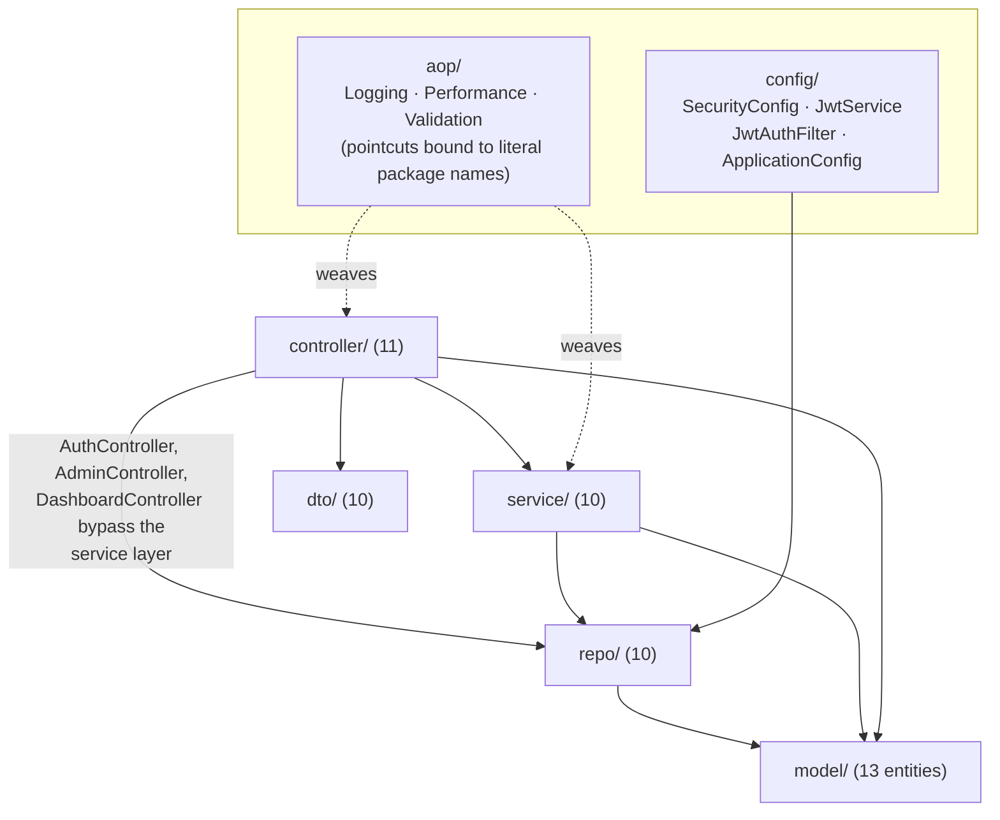
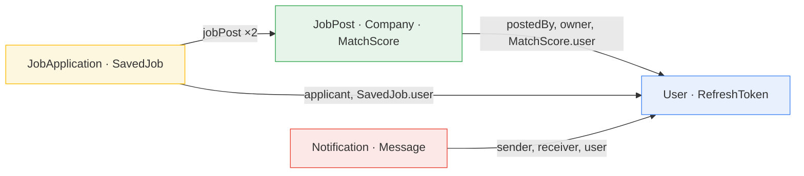

# Monolith → Microservices Migration Plan

**Subject:** `com.tausib.springjobportal` (Spring Boot 3.4.3, Java 21, PostgreSQL, React 19)
**Status:** **ABANDONED — not being followed.** On 2026-08-29 the decision was taken to stay with a
modular monolith, so no part of this plan will be executed. It is kept only because §1 (inventory)
and §2 (dependency graph) record analysis that was expensive to produce.

It also describes a codebase that no longer exists: written against 13 entities (now 8), WebSocket
messaging, `AdminController`, `JobAlert`, and the old `model/ repo/ service/ controller/ dto/`
layout, all of which were removed in phases 2 and 3 of the layered-architecture refactor. Read
`docs/ARCHITECTURE.md` for the current shape; nothing below is being kept in sync.

**Original status:** Analysis only. No source file has been modified.
**Date:** 2026-08-28

---

## Assumptions

Three decisions were not confirmed and are taken as defaults below. Each is isolated enough to
overturn without rewriting the rest of this document.

| # | Assumption | Where it matters |
|---|---|---|
| A1 | The pieces not named in the six-service list (`AIService`/`MatchScore`, `AdminController`, `DashboardController`, `EmailService`, `FileStorageService`, `JobAlert`) fold into the nearest owning service. No seventh deployable. | §3 |
| A2 | File bytes move to **MinIO** (S3 API); `FileStorageService` becomes a shared library in `common`. | §3, §5 Phase 4 |
| A3 | Repository becomes a **multi-module Maven monorepo** with a `common` module. | §5 Phase 1 |

Confirmed by the user: **database-per-service from the start**, **Kafka** as the async backbone,
**Docker Compose** as the runtime for everything.

One clarification on "database-per-service": the target runs **one Postgres container hosting four
independent databases** (`auth_db`, `job_db`, `application_db`, `notification_db`), not four Postgres
containers. Postgres cannot join or foreign-key across databases, so the isolation guarantee is
identical to separate instances; the only thing shared is the process. Splitting into four containers
later is a compose-file change, not a code change.

---

## 1. Inventory of the current codebase

### 1.1 Entities (13 + 4 enums)

All entities live in `com.tausib.springjobportal.model`. Schema is generated by
`spring.jpa.hibernate.ddl-auto=update` — **there are no migration scripts**, which is itself a
migration risk (see §5 Phase 0).

#### `User` — table `users`

The most important class in the codebase and the hardest to split.

| Field | Type | Notes |
|---|---|---|
| `id` | `Integer` | `@Id`, identity |
| `fullName` | `String` | |
| `email` | `String` | `unique`, `nullable=false` |
| `password` | `String` | `nullable=false`, `@JsonIgnore`, BCrypt |
| `role` | `UserRole` | `@Enumerated(STRING)`, `nullable=false` |
| `phone`, `bio`, `location` | `String` | `bio` is `TEXT` |
| `profilePhotoPath`, `resumePath` | `String` | relative paths into `./uploads` |
| `skills` | `List<String>` | `@ElementCollection(EAGER)` → table `user_skills` |
| `experienceYears` | `Integer` | |
| `currentJobTitle`, `linkedinUrl`, `githubUrl`, `portfolioUrl` | `String` | |
| `isEmailVerified` | `Boolean` | default `false` |
| `emailVerificationToken`, `passwordResetToken`, `passwordResetExpiry` | | all `@JsonIgnore` |
| `isProfilePublic`, `isBanned` | `Boolean` | defaults `true` / `false` |
| `createdAt`, `updatedAt` | `LocalDateTime` | Hibernate timestamps |

Relationships: **none outbound.** `User` is referenced by seven other entities and references nothing.
That makes it a pure leaf in the ownership graph and the obvious first extraction.

**`User implements UserDetails`** (`model/User.java:29`). It is simultaneously:

1. a JPA entity,
2. the Spring Security principal (`getAuthorities()` synthesises `ROLE_ + role.name()`,
   `getUsername()` returns the email, `isAccountNonLocked()` returns `!isBanned`),
3. a JSON response DTO — the class-level `@JsonIgnoreProperties` at `model/User.java:26` is the only
   thing preventing password hashes and reset tokens from being serialised to clients.

Every controller signature that reads `@AuthenticationPrincipal User user` (33 methods)
depends on role 2. Once `users` lives only in auth-service, no other service can construct this
object. This single fact drives most of §4.

#### `JobPost` — table `job_post`

| Field | Type | Notes |
|---|---|---|
| `postId` | `Integer` | `@Id`, identity |
| `postProfile` | `String` | job title |
| `postDesc` | `String` | `TEXT` |
| `reqExperience` | `Integer` | |
| `postTechStack` | `List<String>` | `@ElementCollection(EAGER)` |
| `postedBy` | `User` | **`@ManyToOne(EAGER)`**, `posted_by_id` |
| `company` | `Company` | `@ManyToOne(EAGER)`, `company_id` |
| `salaryMin`, `salaryMax` | `BigDecimal` | |
| `location` | `String` | |
| `jobType` | `JobType` | `@Enumerated(STRING)`, default `FULL_TIME` |
| `isRemote`, `isActive`, `isFeatured`, `isApproved` | `Boolean` | `isApproved` defaults **`true`**, so the admin approval queue is always empty in practice |
| `applicationDeadline` | `LocalDate` | |
| `viewCount` | `Integer` | default `0` |
| `postedDate` | `LocalDateTime` | |

#### `Company` — table `companies`

`id`, `name` (`nullable=false`), `description` (`TEXT`), `website`, `location`, `industry`, `size`,
`logoPath`, `createdAt`, plus `owner` → `User` (**`@ManyToOne(EAGER)`, `owner_id`, `nullable=false`**).

#### `JobApplication` — table `job_applications`

`id`, `coverLetter` (`TEXT`), `status` (`ApplicationStatus`, default `PENDING`), `appliedDate`, plus:

- `jobPost` → `JobPost` — **`@ManyToOne(EAGER)`, `nullable=false`**
- `applicant` → `User` — **`@ManyToOne(EAGER)`, `nullable=false`**

Both relations cross a boundary. This entity is the epicentre of the migration.

#### `SavedJob` — table `saved_jobs`

`id`, `savedAt`, `user` → `User` (`@ManyToOne(LAZY)`, non-null), `jobPost` → `JobPost`
(`@ManyToOne(EAGER)`, non-null). Unique constraint on `(user_id, job_post_id)` — that constraint
cannot survive a database split and becomes an application-level check.

#### `Message` — table `messages`

`id`, `content` (`TEXT`, non-null), `isRead` (default `false`), `sentAt`, plus **two** `@ManyToOne(EAGER)`
relations to `User`: `sender` and `receiver`, both non-null.

#### `Notification` — table `notifications`

`id`, `title` (non-null), `message` (`TEXT`), `type` (`NotificationType`, non-null), `actionUrl`,
`isRead` (default `false`), `createdAt`, plus `user` → `User` (`@ManyToOne(LAZY)`, non-null).

#### `MatchScore` — table `match_scores`

`id`, `score` (`Double`, 0–100, non-null), `generatedAt`, `matchedSkills` and `missingSkills`
(both `@ElementCollection(EAGER)` → tables `matched_skills` / `missing_skills`), plus
`user` → `User` (`@ManyToOne(LAZY)`, non-null) and `jobPost` → `JobPost` (`@ManyToOne(LAZY)`, non-null).

#### `RefreshToken` — table `refresh_tokens`

`id`, `token` (unique, non-null), `expiryDate` (non-null), `revoked` (default `false`),
`user` → `User` (`@ManyToOne(LAZY)`, non-null). Stays wholly inside auth-service.

#### `JobAlert` — table `job_alerts`

`id`, `keywords`, `location`, `jobType`, `minExperience`, `maxExperience`, `isActive` (default `true`),
`createdAt`, `user` → `User` (`@ManyToOne(LAZY)`, non-null).

**`JobAlertRepo` is injected by no service and referenced by no controller.** This entity and its
repository are dead code.

#### Enums (4)

`UserRole {EMPLOYER, JOB_SEEKER, ADMIN}`, `JobType {FULL_TIME, PART_TIME, CONTRACT, INTERNSHIP,
FREELANCE}`, `ApplicationStatus {PENDING, REVIEWED, ACCEPTED, REJECTED}`,
`NotificationType {APPLICATION_RECEIVED, APPLICATION_STATUS_CHANGED, JOB_ALERT, MESSAGE_RECEIVED,
PROFILE_VIEWED, SYSTEM_ANNOUNCEMENT}`.

All four are serialised into API payloads and cross service boundaries as values → they belong in
the `common` module.

#### Element-collection tables

`user_skills`, `JobPost.postTechStack` (default-named), `matched_skills`, `missing_skills`. Each
travels with its owning entity — **except** `user_skills`, which `AIService` reads while scoring jobs.
After the split that data is owned by auth-service but consumed by job-service (see §4).

### 1.2 Repositories (10)

| Repository | Entity | Non-trivial queries |
|---|---|---|
| `UserRepo` | `User` | `findByEmail`, `findByEmailVerificationToken`, `findByPasswordResetToken`, `findByRole`, `countByRole`, `searchUsers` (JPQL LIKE on name/email) |
| `JobRepo` | `JobPost` | `findByIsActiveTrue(Pageable)`, `findByPostedById`, `countByPostedById`, `findByIsFeaturedTrueAndIsActiveTrue`, `findByIsApprovedFalse`, `searchJobs` (JPQL), `advancedSearch` (6-parameter JPQL with null guards) |
| `JobApplicationRepo` | `JobApplication` | `findByApplicantId`, `findByJobPostPostId`, `findByJobPostPostIdAndApplicantId` |
| `SavedJobRepo` | `SavedJob` | `findByUserId`, `findByUserIdAndJobPostPostId`, `existsBy…`, `deleteBy…` |
| `CompanyRepo` | `Company` | `findByOwnerId`, `findByNameIgnoreCase` |
| `MessageRepo` | `Message` | `findConversation` (JPQL OR on both directions), `findConversationPartnerIds` (JPQL `DISTINCT CASE`), `countByReceiverIdAndIsReadFalse` |
| `NotificationRepo` | `Notification` | `findByUserIdOrderByCreatedAtDesc`, unread variants, `countByUserIdAndIsReadFalse` |
| `MatchScoreRepo` | `MatchScore` | `findByUserIdAndJobPostPostId`, ordered-by-score finders |
| `RefreshTokenRepo` | `RefreshToken` | `findByToken`, `@Modifying deleteByUserId` |
| `JobAlertRepo` | `JobAlert` | **unused** |

Note that the derived-query names already traverse relations by ID (`findByJobPostPostId`,
`findByUserIdAndJobPostPostId`). Those translate cleanly to plain ID columns — the traversal is
syntactic, not semantic. That is a meaningful help in §4.

### 1.3 Controllers and endpoints (11 controllers, 66 endpoints)

Authorization is applied through **two independent mechanisms** that must both be reproduced after
the split, in different places:

- coarse path rules in `config/SecurityConfig.java:36-53` (filter-chain level), and
- per-method `@PreAuthorize` (enabled by `@EnableMethodSecurity`).

| Controller | Method + path | Guard | New owner |
|---|---|---|---|
| `AuthController` | `POST /api/auth/register` | public | auth |
| | `POST /api/auth/login` | public | auth |
| | `POST /api/auth/refresh-token` | public | auth |
| | `POST /api/auth/verify-email` | public | auth |
| | `POST /api/auth/forgot-password` | public | auth |
| | `POST /api/auth/reset-password` | public | auth |
| `UserController` | `GET /api/users/me` | authenticated | auth |
| | `GET /api/users/{id}` | authenticated | auth |
| | `PUT /api/users/me` | authenticated | auth |
| | `POST /api/users/me/photo` | authenticated | auth |
| | `POST /api/users/me/resume` | authenticated | auth |
| | `PATCH /api/users/me/visibility` | authenticated | auth |
| `JobRestController` | `GET /api/jobs` | public | job |
| | `GET /api/jobs/paginated` | public | job |
| | `GET /api/jobs/search` | public | job |
| | `GET /api/jobs/featured` | public | job |
| | `GET /api/jobs/keyword/{keyword}` | public | job |
| | `GET /api/jobs/{postId}` | public | job |
| | `GET /api/jobs/my` | `EMPLOYER` | job |
| | `POST /api/jobs` | `EMPLOYER` | job |
| | `PUT /api/jobs/{postId}` | `EMPLOYER` | job |
| | `DELETE /api/jobs/{postId}` | `EMPLOYER` | job |
| | `POST /api/jobs/{postId}/save` | authenticated | **application** |
| | `DELETE /api/jobs/{postId}/save` | authenticated | **application** |
| | `GET /api/jobs/saved` | authenticated | **application** |
| | `GET /api/jobs/{postId}/is-saved` | authenticated | **application** |
| | `GET /api/jobs/load` | public | delete (no-op) |
| `CompanyController` | `POST /api/companies` | `EMPLOYER` | job |
| | `PUT /api/companies/{id}` | `EMPLOYER` | job |
| | `GET /api/companies` | public | job |
| | `GET /api/companies/{id}` | public | job |
| | `GET /api/companies/my` | `EMPLOYER` | job |
| | `POST /api/companies/{id}/logo` | `EMPLOYER` | job |
| | `DELETE /api/companies/{id}` | `EMPLOYER` | job |
| `JobApplicationController` | `POST /api/applications/job/{jobId}` | `JOB_SEEKER` | application |
| | `GET /api/applications/my` | `JOB_SEEKER` | application |
| | `GET /api/applications/job/{jobId}` | `EMPLOYER` | application |
| | `PATCH /api/applications/{id}/status` | `EMPLOYER` | application |
| `NotificationController` | `GET /api/notifications` | authenticated | notification |
| | `GET /api/notifications/unread` | authenticated | notification |
| | `GET /api/notifications/unread-count` | authenticated | notification |
| | `PATCH /api/notifications/{id}/read` | authenticated | notification |
| | `POST /api/notifications/mark-all-read` | authenticated | notification |
| | `DELETE /api/notifications/{id}` | authenticated | notification |
| `MessagingController` | `POST /api/messages` | authenticated | notification |
| | `GET /api/messages/conversation/{userId}` | authenticated | notification |
| | `GET /api/messages/conversations` | authenticated | notification |
| | `GET /api/messages/unread-count` | authenticated | notification |
| | `POST /api/messages/read/{senderId}` | authenticated | notification |
| `AdminController` | `GET /api/admin/users` | `ADMIN` | auth |
| | `GET /api/admin/users/search` | `ADMIN` | auth |
| | `PATCH /api/admin/users/{id}/ban` | `ADMIN` | auth |
| | `PATCH /api/admin/users/{id}/unban` | `ADMIN` | auth |
| | `DELETE /api/admin/users/{id}` | `ADMIN` | auth |
| | `GET /api/admin/jobs/pending` | `ADMIN` | job |
| | `PATCH /api/admin/jobs/{id}/approve` | `ADMIN` | job |
| | `PATCH /api/admin/jobs/{id}/reject` | `ADMIN` | job |
| | `GET /api/admin/stats` | `ADMIN` | auth (fan-out) |
| `DashboardController` | `GET /api/dashboard/employer` | `EMPLOYER` | application |
| `AIController` | `GET /api/ai/match-score/{jobId}` | `JOB_SEEKER` | job |
| | `GET /api/ai/cover-letter/{jobId}` | `JOB_SEEKER` | job |
| | `GET /api/ai/salary-estimate` | `JOB_SEEKER` | job |
| | `GET /api/ai/resume-suggestions` | `JOB_SEEKER` | job |
| | `GET /api/ai/recommended-jobs` | `JOB_SEEKER` | job |
| | `POST /api/ai/auto-apply` | `JOB_SEEKER` | **application** (relocated, see §2) |
| `FileController` | `GET /api/files?path=…` | **public** | see §3 |

**Response shape warning.** Only 10 DTOs exist (`AuthRequest`, `AuthResponse`, `RegisterRequest`,
`ProfileUpdateRequest`, `CompanyRequest`, `JobSearchRequest`, `PasswordResetRequest`,
`NewPasswordRequest`, `AdminStats`, `DashboardStats`). Every other endpoint returns **JPA entities
directly**, so the wire format is whatever Hibernate + Jackson produce, including eagerly-fetched
relations. `GET /api/applications/my` currently returns each application with its full `JobPost`
inlined, which in turn inlines `postedBy` (a `User`) and `company`. Preserving those payloads across
the split is a hard requirement — the React frontend reads the nested fields — and it is the reason
several relations in §4 are resolved by duplication rather than by an ID alone.

### 1.4 Services (10) and their dependencies

| Service | Constructor dependencies | Future service |
|---|---|---|
| `UserService` | `UserRepo`, `PasswordEncoder`, `EmailService` | auth |
| `RefreshTokenService` | `RefreshTokenRepo` | auth |
| `JobService` | `JobRepo`, `SavedJobRepo` | **splits** — job + application |
| `CompanyService` | `CompanyRepo` | job |
| `AIService` | `MatchScoreRepo` | job |
| `JobApplicationService` | `JobApplicationRepo`, `JobRepo`, `UserRepo`, `NotificationService`, `EmailService` | **application** — touches 3 boundaries |
| `NotificationService` | `NotificationRepo` | notification |
| `MessagingService` | `MessageRepo`, `UserRepo` | notification |
| `EmailService` | `JavaMailSender` | notification |
| `FileStorageService` | *(none — `@Value` upload dir)* | `common` library |

`JobApplicationService` is the most entangled class in the codebase: it writes to its own repository,
reads two repositories that will belong to other services, and synchronously calls two services that
will belong to a third. Every one of those four couplings is addressed in §4.

`JobService` is the only service that must be **split in two**: its job-post methods go to
job-service, its saved-job methods (`saveJob`, `unsaveJob`, `getSavedJobs`, `isJobSaved`) go to
application-service.

### 1.5 Spring Security / JWT flow (current)

**Registration** (`AuthController.register`) — note it uses `UserRepo` directly, bypassing
`UserService`:

```
POST /api/auth/register
  → UserRepo.findByEmail (duplicate check)
  → PasswordEncoder.encode (BCrypt)
  → UserRepo.save
  → UserService.generateVerificationToken → EmailService.sendVerificationEmail (@Async)
  → JwtService.generateToken
  → RefreshTokenService.createRefreshToken (persisted row)
  → AuthResponse{token, refreshToken, id, fullName, email, role}
```

**Login:**

```
POST /api/auth/login
  → AuthenticationManager.authenticate
      → DaoAuthenticationProvider
          → ApplicationConfig.userDetailsService  → UserRepo.findByEmail
          → BCryptPasswordEncoder.matches
  → explicit isBanned check → 403
  → JwtService.generateToken + RefreshTokenService.createRefreshToken
```

**Every authenticated request:**

```
JwtAuthFilter (OncePerRequestFilter, before UsernamePasswordAuthenticationFilter)
  → read "Authorization: Bearer …"; absent → continue unauthenticated
  → JwtService.extractUsername (parse + verify HS256 signature)
  → UserDetailsService.loadUserByUsername  ← DATABASE READ ON EVERY REQUEST
  → JwtService.isTokenValid (subject match + not expired)
  → SecurityContextHolder.setAuthentication(User entity as principal)
```

**Token contents.** `JwtService.buildToken` (`config/JwtService.java:47-60`) sets only
`sub` (the email), `iat`, and `exp`, signed HS256 with a Base64 secret from `jwt.secret`. There is
**no user id claim and no role claim**. This is the single most consequential finding for the
migration: every downstream service would need a database read to learn who the caller is and what
role they hold — which is impossible once `users` lives only in auth-service. Adding `uid` and `role`
claims is a **prerequisite**, not an optimisation, and is scheduled as Phase 0.

**Configuration.** `jwt.expiration=86400000` (24 h access token), `jwt.refresh-expiration=604800000`
(7 days). Both the JWT secret and the datasource password are committed in
`src/main/resources/application.properties`.

**Exception behaviour.** `JwtAuthFilter` catches every parse failure, prints to `System.err`, and
continues the chain unauthenticated — so an invalid token yields a 403 from the authorization layer
rather than a 401. The frontend's axios interceptor (`services/api.js`) only reacts to **401**, so
expired tokens currently do not trigger the logout path.

### 1.6 WebSocket messaging setup

**There is no WebSocket implementation.** Concretely:

- `spring-boot-starter-websocket` is declared in `pom.xml`.
- `SecurityConfig` permits `/ws/**`.
- There is **no** `@EnableWebSocketMessageBroker`, no `WebSocketConfigurer`, no `StompEndpointRegistry`
  registration, no `SimpMessagingTemplate` injection, and no handler class anywhere under
  `src/main/java`. A repository-wide search for `WebSocket`, `SimpMessag`, and `/ws` matches
  `SecurityConfig` and nothing else.
- The frontend contains no WebSocket or STOMP client. `messageService.js` is plain axios.

What actually exists is REST messaging (`/api/messages/**`) backed by `MessagingService` + `MessageRepo`.
The only periodic refresh in the entire frontend is `NotificationBell.jsx:21`, a 30-second
`setInterval` on the unread **count**. The `Messages` page does not poll at all — an open conversation
never updates until the user reloads.

**Consequence for the migration:** notification-service must **build** real-time messaging, not port
it. That is new feature work inside a migration, and the plan below schedules it explicitly (Phase 6)
rather than assuming it comes for free.

### 1.7 File-storage implementation

`FileStorageService` (constructor-configured with `@Value("${app.upload.dir:./uploads}")`):

- On construction, creates `./uploads` plus subdirectories `photos/`, `resumes/`, `logos/`.
- `storeProfilePhoto` / `storeResume` / `storeCompanyLogo` validate, then write via
  `Files.copy(..., REPLACE_EXISTING)` and return a **relative path string** like
  `photos/photo_7_1a2b3c4d.jpg`.
- Validation: non-empty, ≤ 10 MB, and an extension allow-list — images `{jpg, jpeg, png, gif, webp}`,
  résumés `{pdf, doc, docx}`. Filenames are `{kind}_{ownerId}_{8 hex chars}.{ext}`.
- `loadFile(path)` reads bytes; `deleteFile(path)` is defined but **called from nowhere** — deleting a
  user or company orphans their files.

The returned path string is persisted into three columns across two future services:
`User.profilePhotoPath`, `User.resumePath` (auth-service) and `Company.logoPath` (job-service).
Bytes are served by `FileController` at `GET /api/files?path=…`, which is `permitAll` and infers
`Content-Type` from the filename extension.

### 1.8 Pre-existing defects found during this analysis

These are all present in the monolith today. They matter here because each one either blocks the
split or gets substantially worse once traffic crosses a network. Fixing them is folded into the
phases in §5 rather than deferred.

| # | Defect | Location | Why it matters here |
|---|---|---|---|
| D1 | **Unauthenticated path traversal.** `loadFile` does `uploadDir.resolve(filePath).normalize()` and never checks the result is still under `uploadDir`; the endpoint is `permitAll`. `GET /api/files?path=../../../../etc/passwd` escapes the upload directory. | `FileStorageService.loadFile`, `SecurityConfig` | Must be fixed while the code moves to `common`; a gateway makes this endpoint more reachable, not less. |
| D2 | **`GET /api/jobs/**` is `permitAll`,** which also matches `/api/jobs/saved` and `/api/jobs/{id}/is-saved`. Both handlers dereference `@AuthenticationPrincipal User user`, so an anonymous request throws NPE → 500. | `SecurityConfig:39`, `JobRestController` | Moving saved-jobs to application-service resolves the path overlap; the routing table in §3 already separates them. |
| D3 | **Missing ownership checks.** `POST /api/companies/{id}/logo` lets any `EMPLOYER` overwrite any company's logo. `GET /api/applications/job/{jobId}` and `PATCH /api/applications/{id}/status` let any `EMPLOYER` read and modify applications for jobs they do not own. `PATCH /api/notifications/{id}/read` and `DELETE /api/notifications/{id}` let any user act on any notification. | `CompanyController`, `JobApplicationController`, `NotificationController` | After the split these checks need data from another service, so they must be added **before** extraction while the join is still local (Phase 0), not after. |
| D4 | **Profile visibility toggle is a no-op.** `PATCH /api/users/me/visibility` mutates a detached entity and never calls `save`. | `UserController.toggleVisibility` | Silent data loss; trivial to fix while the code is being touched anyway. |
| D5 | **`GET` performs a write.** `JobService.getJob` increments `viewCount` and saves on every read. | `JobService.getJob` | Gateway retries and any read caching will double-count or deadlock. Needs to become a fire-and-forget event before a gateway sits in front of it. |
| D6 | **Full-table scan + two-hop traversal.** `getStatusBreakdown` calls `findAll()` then filters in memory on `a.getJobPost().getPostedBy().getId()`. | `JobApplicationService:100-110` | Cannot survive the split in any form. See §2 and §4. |
| D7 | **N+1 user lookups.** `getConversationPartners` loops `userRepo.findById` per partner. | `MessagingService:40-42` | Becomes N remote calls instead of N local queries. Must be batched during extraction. |
| D8 | **`LoggingAspect` logs every method's full return value** at INFO, including `User` objects. This is why `run-log.txt` is 1.4 MB. | `aop/LoggingAspect.java` | Multiplies across services; user PII in logs. |
| D9 | **Secrets committed**: `jwt.secret`, datasource password, mail password. | `application.properties` | Every service needs the JWT secret; committing it four times is four times worse. |
| D10 | **No schema migrations.** `ddl-auto=update` only. | `application.properties` | Splitting one database into four requires deterministic, reviewable schema+data steps. Flyway is introduced in Phase 0. |

---

## 2. Dependency graph and boundary crossings

### 2.1 Package-level graph



Two structural observations:

1. **The service layer is not a boundary.** `AuthController` injects `UserRepo`, `AdminController`
   injects `UserRepo` + `JobRepo` + `JobApplicationRepo`, and `DashboardController` injects `JobRepo`.
   Three controllers reach past the services straight into persistence. Each of those is a boundary
   violation that has to be closed before extraction, because a controller in one service cannot
   inject another service's repository.
2. **`config/` depends on `repo/`.** `ApplicationConfig.userDetailsService` is a lambda over
   `UserRepo.findByEmail`. Security is wired directly to the user table — which is precisely the
   coupling that must be severed for services that do not own that table.

### 2.2 Target service boundaries overlaid



Every arrow is a JPA relation that must be cut. Note that **auth is a pure sink** — nothing in
auth-service points outward — which is why it is extracted first in §5.

### 2.3 Cross-boundary JPA relationships

The codebase has **14 `@ManyToOne` relations. 11 of them cross a future service boundary.**

| # | Relation | Join column | Fetch | Nullable | Crossing |
|---|---|---|---|---|---|
| R1 | `JobPost.postedBy → User` | `posted_by_id` | **EAGER** | yes | job → auth |
| R2 | `Company.owner → User` | `owner_id` | **EAGER** | **no** | job → auth |
| R3 | `MatchScore.user → User` | `user_id` | LAZY | **no** | job → auth |
| R4 | `JobAlert.user → User` | `user_id` | LAZY | **no** | job → auth *(dead code)* |
| R5 | `JobApplication.jobPost → JobPost` | `job_post_id` | **EAGER** | **no** | application → job |
| R6 | `JobApplication.applicant → User` | `applicant_id` | **EAGER** | **no** | application → auth |
| R7 | `SavedJob.jobPost → JobPost` | `job_post_id` | **EAGER** | **no** | application → job |
| R8 | `SavedJob.user → User` | `user_id` | LAZY | **no** | application → auth |
| R9 | `Message.sender → User` | `sender_id` | **EAGER** | **no** | notification → auth |
| R10 | `Message.receiver → User` | `receiver_id` | **EAGER** | **no** | notification → auth |
| R11 | `Notification.user → User` | `user_id` | LAZY | **no** | notification → auth |

Staying internal (no work required):

| Relation | Service |
|---|---|
| `JobPost.company → Company` | job |
| `MatchScore.jobPost → JobPost` | job |
| `RefreshToken.user → User` | auth |

**Why `EAGER` matters.** Seven of the eleven crossings are `EAGER`. Today Hibernate resolves them
with a join, and the result is serialised inline into the JSON response. After the split each one is
either a network call or a column that must already hold the data. An `EAGER` crossing is therefore
strictly harder to cut than a `LAZY` one — the payload contract depends on it. §4 resolves the seven
`EAGER` crossings with duplication or batched calls, and the four `LAZY` ones with a bare ID.

**Also affected: `user_skills`.** Not a `@ManyToOne`, but `AIService.calculateMatchScore` reads
`user.getSkills()` and `user.getExperienceYears()` while running inside what becomes job-service. The
collection table is owned by auth-service. This is a twelfth crossing in everything but annotation.

### 2.4 The worst crossing

`JobApplicationService.getStatusBreakdown` (`service/JobApplicationService.java:100-110`):

```java
List<JobApplication> all = applicationRepo.findAll().stream()
        .filter(a -> a.getJobPost().getPostedBy() != null &&
                a.getJobPost().getPostedBy().getId().equals(employerId))
        .collect(Collectors.toList());
```

This loads **every application in the system**, then for each one traverses
`JobApplication → JobPost` (application → job boundary) and then `JobPost → User`
(job → auth boundary) — two hops across two different service boundaries, per row, in memory.

There is no remote-call arrangement that makes this acceptable. It is resolved in §4 by
denormalising `employerId` directly onto `JobApplication`, which also removes the full-table scan
that exists today.

### 2.5 Cross-boundary direct service calls

| # | Caller → callee | Trigger | Sync or event | Rationale |
|---|---|---|---|---|
| C1 | `JobApplicationService` → `NotificationService.createNotification` | apply | **event** | already fire-and-forget; the applicant's request must not fail because notifications are down |
| C2 | `JobApplicationService` → `EmailService.sendApplicationNotification` | apply | **event** | already `@Async` |
| C3 | `JobApplicationService` → `NotificationService.createNotification` | status change | **event** | as C1 |
| C4 | `JobApplicationService` → `EmailService.sendStatusUpdateEmail` | status change | **event** | already `@Async` |
| C5 | `UserService` → `EmailService.sendVerificationEmail` | register | **event** | already `@Async` |
| C6 | `UserService` → `EmailService.sendPasswordResetEmail` | forgot-password | **event** | already `@Async` |
| C7 | `JobApplicationService` → `JobRepo.findById` | apply — validate job exists, read title/company | **sync** | the request must fail if the job is gone; correctness depends on the answer |
| C8 | `JobApplicationService` → `UserRepo.findById` | apply — read applicant snapshot | **sync** | needed to build the record being written |
| C9 | `MessagingService` → `UserRepo.findById` (loop) | conversation partner list | **sync, batched** | rendering blocks on it; batching also fixes D7 |
| C10 | `DashboardController` → `JobRepo.countByPostedById` + `JobService.getJobsByEmployer` | employer dashboard | **sync** | read-only aggregate the user is waiting on |
| C11 | `AdminController` → `UserRepo`/`JobRepo`/`JobApplicationRepo` counts | `/api/admin/stats` | **sync, cached** | rare admin read; staleness of a few minutes is acceptable |
| C12 | `AIController` → `JobApplicationService.applyToJob` | `/api/ai/auto-apply` | **relocated** | see below |
| C13 | `AIService` → `User.getSkills()` | match scoring | **sync, cached** | small payload, changes rarely |
| C14 | `JobService.saveJob` → `JobRepo.findById` | bookmark a job | **sync** | validates the job exists before writing the bookmark |

### 2.6 Dependency cycle to avoid

`/api/ai/auto-apply` (`AIController.java:68-88`) is the only place where job-side code **creates an
application**: it scores jobs, then loops calling `applicationService.applyToJob`.

If `AIController` stays in job-service, then job-service calls application-service (to create
applications) while application-service already calls job-service (to validate and snapshot jobs) —
a hard cycle between two services.

**Resolution:** `/api/ai/auto-apply` moves to **application-service**, which calls job-service's
existing `/api/ai/recommended-jobs` to obtain the match list and then applies locally. The dependency
becomes one-directional (application → job), matching every other application-side call. The other
five `/api/ai/**` endpoints are pure reads and stay in job-service.

### 2.7 Other cross-cutting concerns

- **Aspects break silently.** All three aspects in `aop/` bind to the literal package
  `com.tausib.springjobportal.service..*` / `controller..*`. Any repackaging makes the pointcuts match
  nothing — with no error, no warning, and no failing test. Each service needs its own aspect
  configuration with a corrected pointcut, or a `common` aspect parameterised by base package.
- **`ValidationAspect` mutates arguments.** It rewrites a negative `postId` passed to
  `JobService.updateJob` into its absolute value (`aop/ValidationAspect.java:17-26`). Its pointcut
  is `args(postid)` against an `int`, while `JobService.updateJob(JobPost)` takes an entity — so the
  advice does not currently match anything. It is dormant, misleading code and should be deleted
  rather than carried into a new service.
- **Unused cache starter.** `spring-boot-starter-cache` is declared with zero `@EnableCaching` and zero
  `@Cacheable` in the codebase. It becomes genuinely needed in the target architecture (§4 caches
  user-profile lookups and admin stats), so it is kept and actually wired up rather than removed.
- **CORS and base URL are hardcoded in two places.** `SecurityConfig.corsConfigurationSource` allows
  `http://localhost:5173` and `:3000`; `src/main/frontend/src/services/api.js` hardcodes
  `http://localhost:8080/api`. There is no Vite proxy. In the target architecture CORS is configured
  **once, at the gateway**, and removed from every downstream service.

---

## 3. Proposed decomposition

Six deployables, all containerised, orchestrated by a single `docker-compose.yml`.

### 3.1 discovery-server

| | |
|---|---|
| **Port** | `8761` |
| **Entities** | none |
| **Endpoints** | Eureka dashboard + registration API only |
| **Depends on** | nothing |
| **Container** | `eclipse-temurin:21-jre-alpine`, first to start; every other service waits on its healthcheck |

Plain `spring-cloud-starter-netflix-eureka-server`. `eureka.client.register-with-eureka=false`,
`fetch-registry=false`.

### 3.2 api-gateway

| | |
|---|---|
| **Port** | `8080` — inherits the monolith's port so the frontend's hardcoded base URL keeps working |
| **Entities** | none |
| **Depends on** | discovery-server (sync); consumes `UserBanned` from Kafka |

Responsibilities:

- **Route** by path prefix via `lb://` Eureka-backed URIs (table below).
- **Validate JWT** at the edge: verify HS256 signature and expiry, reject with **401** before any
  proxying. Note this fixes the current behaviour where an invalid token yields 403, which the
  frontend's 401-only interceptor ignores.
- **Forward claims** as `X-User-Id`, `X-User-Email`, `X-User-Role` headers, stripping any
  client-supplied values first so they cannot be spoofed.
- **Own CORS** for the whole system; downstream services carry no CORS config.
- **Proxy the WebSocket upgrade** to notification-service.
- **Maintain a ban denylist** fed by the `UserBanned` Kafka topic, with entries expiring after the
  access-token TTL (see §4.5).
- Aggregate Swagger from each service's `/v3/api-docs`.

It does **not** aggregate business data — `/api/admin/stats` is composed in auth-service, not here,
so the gateway stays a routing concern.

**Routing table** (covers all 66 endpoints from §1.3):

| Route predicate | Target |
|---|---|
| `/api/auth/**` | auth-service (public) |
| `/api/users/**` | auth-service |
| `/api/admin/users/**`, `/api/admin/stats` | auth-service |
| `/api/jobs/saved`, `/api/jobs/*/save`, `/api/jobs/*/is-saved` | **application-service** — declared *before* the generic `/api/jobs/**` route so it wins |
| `/api/jobs/**` | job-service |
| `/api/companies/**` | job-service |
| `/api/admin/jobs/**` | job-service |
| `/api/ai/auto-apply` | **application-service** — declared before `/api/ai/**` |
| `/api/ai/**` | job-service |
| `/api/applications/**` | application-service |
| `/api/dashboard/**` | application-service |
| `/api/notifications/**` | notification-service |
| `/api/messages/**` | notification-service |
| `/ws/**` | notification-service (WebSocket upgrade) |
| `/api/files/**` | see §3.7 |

Route ordering is load-bearing in two places (saved-jobs and auto-apply). Both are called out above
because a misordered route silently sends the request to the wrong service.

### 3.3 auth-service

| | |
|---|---|
| **Port** | `8081` · **Database** `auth_db` |
| **Owns** | `User`, `RefreshToken`, `user_skills` |

**Endpoints:** all of `/api/auth/**` (6), all of `/api/users/**` (6), `/api/admin/users/**` (5),
`/api/admin/stats` (1).

**Internal API** (not routed through the gateway; service-to-service only):

- `GET /internal/users?ids=1,2,3` → batch of `{id, fullName, email, profilePhotoPath, resumePath}`.
  Batch-first by design, because the two heaviest consumers (§4 R9/R10 and R6) both need sets of users.
- `GET /internal/users/{id}/profile` → `{id, skills[], experienceYears, currentJobTitle, location}`
  for AI scoring.

**Publishes:** `UserRegistered`, `PasswordResetRequested`, `UserProfileUpdated`, `UserBanned`.

**Calls out to:** job-service and application-service `/internal/stats`, **synchronously and cached**,
only for `/api/admin/stats`.

> **Trade-off, stated plainly.** Putting `/api/admin/stats` here means auth-service makes outbound
> calls to two peers, which slightly compromises its status as a pure sink. The alternative — a
> seventh admin-BFF deployable — was rejected as disproportionate for one cached endpoint. If
> auth-service must stay dependency-free, this endpoint is the one thing to move, and the gateway
> or a small BFF is where it would go.

### 3.4 job-service

| | |
|---|---|
| **Port** | `8082` · **Database** `job_db` |
| **Owns** | `JobPost`, `Company`, `MatchScore`, `postTechStack`, `matched_skills`, `missing_skills` |

**Endpoints:** `/api/jobs/**` except the four saved-job paths (11), `/api/companies/**` (7),
`/api/ai/**` except auto-apply (5), `/api/admin/jobs/**` (3).

**Internal API:** `GET /internal/jobs?ids=…` → batch of
`{postId, postProfile, companyName, location, salaryMin, salaryMax, jobType, isActive, applicationDeadline, postedById}`;
`GET /internal/stats` → `{totalJobs, pendingApprovals}`.

**Publishes:** `JobPosted`, `JobViewed` (replaces the write-on-read in D5).

**Consumes:** `UserProfileUpdated` (to refresh the denormalised employer snapshot, §4 R1).

**Calls out to:** auth-service `/internal/users/{id}/profile`, synchronously and cached, for AI scoring.

Per assumption A1, this service absorbs `AIService` and `MatchScore`. The reason is
`getRecommendedJobs`, which scores the **entire** job corpus in one request
(`AIController.java:63` passes `jobService.getAllJobs()` straight into the scorer). Hosting AI
anywhere else turns that into a full-table transfer over the network per request. Co-locating it
means the corpus stays local and only the user's skill list — a handful of strings — moves.

`JobAlert` is **deleted**, not migrated (§4 R4).

### 3.5 application-service

| | |
|---|---|
| **Port** | `8083` · **Database** `application_db` |
| **Owns** | `JobApplication`, `SavedJob` |

**Endpoints:** `/api/applications/**` (4), the four saved-job paths lifted out of `JobRestController`,
`/api/dashboard/employer` (1), `/api/ai/auto-apply` (1, relocated per §2.6).

**Internal API:** `GET /internal/stats` → `{totalApplications}`;
`GET /internal/applications/count?jobIds=…` for employer dashboards.

**Publishes:** `ApplicationSubmitted`, `ApplicationStatusChanged`.

**Calls out to:** job-service `/internal/jobs` (sync, batched — validating an apply, and hydrating the
saved-jobs list); auth-service `/internal/users` (sync, batched — applicant snapshot at apply time).

This service holds the denormalised `employerId` column that replaces D6, and the unique
`(userId, jobPostId)` constraint on `SavedJob` — which survives intact, since both columns are now
plain integers in this service's own database.

### 3.6 notification-service

| | |
|---|---|
| **Port** | `8084` · **Database** `notification_db` |
| **Owns** | `Notification`, `Message`, `EmailService` |

**Endpoints:** `/api/notifications/**` (6), `/api/messages/**` (5), and `/ws/**` — the STOMP endpoint
that **must be built** (§1.6).

**Consumes:** `UserRegistered` → verification email; `PasswordResetRequested` → reset email;
`ApplicationSubmitted` → notification + employer email; `ApplicationStatusChanged` → notification +
applicant email; `JobPosted` → reserved for the job-alert feature if it is ever revived.

**Calls out to:** auth-service `/internal/users` (sync, batched) for message-partner display data —
and only for that.

This service is the sole owner of every outbound communication channel: in-app notification, email,
and WebSocket push. Consolidating them is what makes C1–C6 collapse into four event consumers.

**New work required.** The WebSocket broker does not exist today. Scope: a STOMP endpoint at `/ws`
with SockJS fallback, JWT handshake authentication via the query parameter (browsers cannot set
headers on the WebSocket handshake), per-user destinations (`/user/queue/messages`,
`/user/queue/notifications`), and gateway upgrade proxying. The frontend then replaces the 30-second
poll in `NotificationBell.jsx:21` with a subscription, and `Messages.jsx` gains live updates it has
never had.

### 3.7 File storage (per assumption A2)

Bytes move to **MinIO**, one bucket `uploads`, keys keeping today's `photos/…`, `resumes/…`,
`logos/…` prefixes so existing stored path strings remain valid.

`FileStorageService` moves to the `common` module with `Files.copy` replaced by `putObject` and
`Files.readAllBytes` by `getObject`; validation logic and the naming scheme are unchanged.
Auth-service uses it for photos and résumés; job-service uses it for logos.

`GET /api/files` is served by whichever service owns the prefix, routed at the gateway
(`/api/files?path=photos/…` → auth-service, `logos/…` → job-service). D1 is fixed at the same time:
the key is validated against the allowed prefixes and rejected if it contains `..`.

> **Why not a shared Docker volume?** It is a smaller diff and works under Compose, but it silently
> constrains every future deployment to a single host. Since the target is explicitly containerised
> multi-service, an S3-compatible store is the honest boundary. MinIO is one container and speaks the
> same API as S3, so a later move to real S3 is a config change.

### 3.8 Summary: which services talk, and how

| From → To | Mechanism | Why |
|---|---|---|
| gateway → all | sync (routing) | it is a proxy |
| application → job | **sync** Feign, batched | apply validation and saved-job hydration are correctness-critical and the user waits on them |
| application → auth | **sync** Feign, batched | applicant snapshot must be written into the record |
| job → auth | **sync** Feign, cached | AI scoring needs live skills |
| notification → auth | **sync** Feign, batched | message-partner display names |
| auth → job, application | **sync** Feign, cached | admin stats only |
| * → notification | **event** (Kafka) | all six notification/email calls are already fire-and-forget |
| auth → job | **event** (`UserProfileUpdated`) | keeps the denormalised employer snapshot fresh |
| auth → gateway | **event** (`UserBanned`) | ban enforcement without a per-request DB read |

**Kafka topics:** `user-events` (`UserRegistered`, `UserProfileUpdated`, `UserBanned`,
`PasswordResetRequested`), `job-events` (`JobPosted`, `JobViewed`), `application-events`
(`ApplicationSubmitted`, `ApplicationStatusChanged`). Keyed by the aggregate id so per-user ordering
holds. Event record classes live in `common`.

### 3.9 Target container topology

| Container | Image / build | Port | Depends on |
|---|---|---|---|
| `postgres` | `postgres:16-alpine` + init script creating 4 DBs | 5432 | — |
| `kafka` | `confluentinc/cp-kafka` (KRaft, no ZooKeeper) | 9092 | — |
| `minio` | `minio/minio` | 9000, 9001 | — |
| `discovery-server` | module build | 8761 | — |
| `api-gateway` | module build | **8080** | discovery |
| `auth-service` | module build | 8081 | discovery, postgres, kafka, minio |
| `job-service` | module build | 8082 | discovery, postgres, kafka, minio |
| `application-service` | module build | 8083 | discovery, postgres, kafka |
| `notification-service` | module build | 8084 | discovery, postgres, kafka |
| `frontend` | nginx serving the Vite build | 5173 | gateway |

All inter-service wiring uses Compose service names; `depends_on` uses `condition: service_healthy`
with Actuator health endpoints, following the pattern already established for `db` in the current
`docker-compose.yml`.

---

## 4. Resolution for every cross-boundary relationship

Three mechanisms, applied deliberately rather than uniformly. The governing question for each
relation is: **does the reader need the data as it is now, or as it was then?**

- *As it was then* → **duplicate** a snapshot (historical records).
- *As it is now* → **ID + synchronous call** (live state).
- *Neither — only the ID is ever used* → **ID alone**.

### 4.1 JPA relations

| # | Relation | Replacement | Justification (one sentence) |
|---|---|---|---|
| **R1** | `JobPost.postedBy → User` | `postedById` **+ duplicated** `{employerName, employerPhotoPath}` on `JobPost`, refreshed by `UserProfileUpdated` | Job listings are the highest-traffic read in the system and currently inline the whole employer, so a Feign call per row would turn a single page of ten results into ten extra round-trips. |
| **R2** | `Company.owner → User` | `ownerId` **only** | It exists solely for the ownership comparison in `CompanyService.updateCompany`/`deleteCompany`, which checks against the caller's own id — no user field is ever read or rendered. |
| **R3** | `MatchScore.user → User` | `userId` **+ sync Feign** for `{skills, experienceYears}`, cached | Scoring must use the candidate's current skill list, and that payload is a few short strings fetched once per scoring run rather than per job. |
| **R4** | `JobAlert.user → User` | **Delete the entity, repository, and table** | `JobAlertRepo` is injected by nothing and no endpoint reads it, so migrating it would carry a never-wired feature across a service boundary for no benefit. |
| **R5** | `JobApplication.jobPost → JobPost` | `jobPostId` **+ duplicated** `{jobTitle, companyName, employerId}` captured at apply time | An application is a historical record that should show the job as it was applied to, and the denormalised `employerId` is exactly what eliminates the two-hop scan in D6. |
| **R6** | `JobApplication.applicant → User` | `applicantId` **+ duplicated** `{applicantName, applicantEmail, resumePath}` captured at apply time | An employer reviewing an application must see the résumé that was actually submitted, not whatever the candidate has uploaded since. |
| **R7** | `SavedJob.jobPost → JobPost` | `jobPostId` **+ sync Feign**, batched per page | A bookmark exists to be acted on later, so it must reflect the job's current salary, deadline, and active flag — the exact opposite of R5, where staleness is the desired behaviour. |
| **R8** | `SavedJob.user → User` | `userId` **only** | The table is only ever queried by `userId` and no user field appears in the response. |
| **R9** | `Message.sender → User` | `senderId` **+ sync Feign**, batched | The conversation-partner list already performs an N+1 `findById` loop, so a single batched call is strictly faster than the current behaviour rather than a regression. |
| **R10** | `Message.receiver → User` | `receiverId` **+ sync Feign**, batched | Same batch as R9 — sender and receiver ids are collected together and resolved in one call per conversation view. |
| **R11** | `Notification.user → User` | `userId` **only** | Notifications are always fetched for the authenticated caller, whose identity already arrives in the JWT, so no lookup is needed at all. |

**Bonus crossing — `user_skills` read from job-service.** Resolved with R3's cached
`/internal/users/{id}/profile` call; the collection stays owned by auth-service and is never copied.

**Consistency note on the duplicated fields.** R1 is the only snapshot that is *kept fresh* (via
`UserProfileUpdated`) because a stale employer name on a live listing is a visible bug. R5 and R6 are
deliberately **never** refreshed — they are point-in-time facts, and refreshing them would be
incorrect. Making that distinction explicit is what keeps "data duplication" from turning into an
unbounded consistency problem: only one of the three copies has to converge.

### 4.2 The `getStatusBreakdown` traversal (D6)

Replaced by the `employerId` column that R5 introduces:

```java
// before: findAll() + in-memory two-hop traversal across two service boundaries
// after:  one indexed query inside application_db
Map<String, Long> breakdown = applicationRepo.countByStatusForEmployer(employerId);
```

No remote call, no scan. This is the clearest case where the migration makes an existing hot path
faster rather than slower.

### 4.3 Direct service calls

| # | Call | Becomes |
|---|---|---|
| C1–C4 | application → notification/email | `ApplicationSubmitted` / `ApplicationStatusChanged` events |
| C5–C6 | auth → email | `UserRegistered` / `PasswordResetRequested` events |
| C7 | apply → validate job | sync `GET /internal/jobs?ids=` |
| C8 | apply → applicant snapshot | sync `GET /internal/users?ids=` |
| C9 | partner list | sync `GET /internal/users?ids=` (batched — fixes D7) |
| C10 | employer dashboard | sync `GET /internal/jobs?ids=` + local `employerId` query |
| C11 | admin stats | sync `GET /internal/stats` ×2, `@Cacheable` with a short TTL |
| C12 | auto-apply | endpoint relocated to application-service (§2.6) |
| C13 | AI skill read | sync `GET /internal/users/{id}/profile`, cached |
| C14 | saveJob validation | sync `GET /internal/jobs?ids=` |

Every event above replaces a call that is **already** `@Async` fire-and-forget, so the change
preserves current behaviour rather than altering it. Every sync call replaces something the caller
genuinely blocks on today.

**Resilience.** Each Feign client gets a timeout, a Resilience4j circuit breaker, and an explicit
fallback: batched user lookups degrade to showing ids without display names; `/api/admin/stats`
degrades to serving the last cached value; job validation on apply **fails closed** with 503, because
writing an application against a job that may not exist is worse than rejecting the request.

### 4.4 Identity — the cross-cutting replacement

`@AuthenticationPrincipal User` appears in 33 controller methods and cannot exist outside
auth-service. Replacement:

```java
// common module
public record AuthPrincipal(Integer id, String email, UserRole role) {}
```

Built by a lightweight filter in each service from the gateway-forwarded claims, performing **no
database lookup**. `@PreAuthorize("hasRole('EMPLOYER')")` keeps working because the filter grants
`ROLE_ + role` as an authority, exactly as `User.getAuthorities()` does today.

This also removes the per-request `UserRepo.findByEmail` in `JwtAuthFilter` — a database read on
every single authenticated request in the current system.

### 4.5 The one genuine regression, and its mitigation

Today a banned user is rejected on their **next request**: `JwtAuthFilter` re-reads the row and
`User.isAccountNonLocked()` returns `false`.

With claims-only validation there is no per-request read, so **a banned user's existing token stays
valid until it expires — and `jwt.expiration` is currently 24 hours.** That is a real security
regression and must not be hidden behind the architecture change.

Mitigation, in order of importance:

1. **Cut the access-token TTL to ~15 minutes.** The refresh-token infrastructure already exists
   (`RefreshToken` entity, `RefreshTokenService`, `POST /api/auth/refresh-token`) and is currently
   near-unused; the frontend gains a refresh-on-401 interceptor. This bounds the exposure window.
2. **Publish `UserBanned`**; the gateway keeps a denylist of banned user ids with entries expiring
   after the access-token TTL. Cheap, in-memory, and self-cleaning.
3. **Revoke refresh tokens on ban** (`RefreshTokenService.revokeAllUserTokens` already exists and is
   already called nowhere) so the ban becomes permanent at the next refresh.

---

## 5. Ordered migration sequence

Ten phases. **After every phase, `docker compose up --build` produces a running system and the React
frontend works end to end.** No phase leaves the repository in a state that does not build.

The strategy is the strangler pattern: stand up the gateway early, then move one service out at a
time behind it, deleting code from the monolith as each route flips. The monolith shrinks to nothing
and its last remains become application-service.

### Phase 0 — Harden the monolith in place

Still one application, one container, one database. Every change here is backward-compatible and
independently useful, which is what makes the later phases mechanical.

1. Introduce **Flyway** and baseline the current schema (D10). Every subsequent schema change is a
   reviewable migration rather than a Hibernate guess.
2. Add **`uid` and `role` claims** to `JwtService.buildToken`. Keep the DB-lookup filter for now —
   tokens simply carry more than is read.
3. Cut `jwt.expiration` to 15 minutes; add refresh-on-401 to the frontend axios interceptor; make
   `JwtAuthFilter` return **401** rather than falling through to 403.
4. Fix **D1** (path traversal), **D3** (three missing ownership checks — while the joins are still
   local), **D4** (visibility no-op).
5. Add plain-ID columns **alongside** every crossing relation (`postedById`, `ownerId`, `applicantId`,
   `jobPostId`, `userId`, `senderId`, `receiverId`) and backfill from the existing foreign keys. The
   `@ManyToOne` relations stay — both representations coexist.
6. Add the denormalised columns from §4: `employerId`, `jobTitle`, `companyName` on `JobApplication`;
   `applicantName`, `applicantEmail`, `resumePath` on `JobApplication`; `employerName`,
   `employerPhotoPath` on `JobPost`. Backfill.
7. Rewrite `getStatusBreakdown` against `employerId` (**D6**).
8. Delete `JobAlert`, `JobAlertRepo`, and `ValidationAspect`; stop logging return values in
   `LoggingAspect` (**D8**).
9. Move `jwt.secret`, datasource password, and mail password to environment variables (**D9**).

**Verify:** full frontend regression. Decode a token and confirm `uid`/`role` are present. Confirm
`/api/files?path=../../etc/passwd` returns 400.

### Phase 1 — Multi-module Maven

Parent `pom.xml` with `<modules>`: `common`, `monolith`. `common` holds the four enums, `AuthPrincipal`,
Kafka event records, and (from Phase 4) `FileStorageService`. `Dockerfile` builds from the parent.
Still exactly one running application.

**Verify:** `./mvnw package` produces both artifacts; `docker compose up` behaves identically; CI green.

### Phase 2 — Infrastructure containers

Add to `docker-compose.yml`: `discovery-server` (new module, Eureka, 8761), `kafka` (KRaft mode),
`minio`. The monolith registers itself with Eureka. Postgres init script pre-creates the four
databases, though only the original is used yet.

**Verify:** Eureka dashboard at `:8761` lists the monolith; `kafka-topics --list` responds; MinIO
console reachable at `:9001`.

### Phase 3 — API gateway

New `api-gateway` module takes port **8080**; the monolith moves to **8090**. The gateway proxies
`/api/**` to the monolith, validates JWTs at the edge, strips and re-sets the `X-User-*` headers, and
owns CORS (removed from the monolith).

The frontend's hardcoded `http://localhost:8080/api` is unchanged — it now reaches the gateway.

**Verify:** every frontend flow — login, register, job search, apply, saved jobs, messages,
notifications, employer dashboard, admin panel, AI tools, file upload and download.

### Phase 4 — File storage to MinIO

`FileStorageService` moves into `common`, backed by the S3 API. A one-off job copies the existing
`./uploads` tree into the `uploads` bucket, preserving key prefixes so stored path strings stay valid.

**Verify:** upload a profile photo, a résumé, and a company logo; confirm each renders; confirm
previously uploaded files still load.

### Phase 5 — Extract auth-service

The largest step, and the reason auth goes first: **nothing in `User` points outward** (§2.2), so it
can be lifted cleanly.

1. New module + container, `auth_db`, Flyway migrations for `users`, `user_skills`, `refresh_tokens`.
2. `pg_dump` those three tables from the monolith database into `auth_db`.
3. Move `AuthController`, `UserController`, `UserService`, `RefreshTokenService`, `JwtService`,
   `ApplicationConfig`, and the `/api/admin/users/**` handlers.
4. Add `/internal/users` and `/internal/users/{id}/profile`.
5. Publish `UserRegistered`, `PasswordResetRequested`, `UserProfileUpdated`, `UserBanned`.
6. In the monolith: delete the `User` entity and every `@ManyToOne` to it, relying on the ID columns
   from Phase 0; replace `@AuthenticationPrincipal User` with `AuthPrincipal`; add a `UserClient`
   Feign client.
7. Flip the gateway routes; drop the migrated tables from the old database.
8. Apply the §4.5 ban mitigations.

**Verify:** register, login, refresh, forgot/reset password, profile update, photo and résumé upload,
admin ban and unban, and — specifically — that a banned user loses access within the token TTL.

### Phase 6 — Extract notification-service

Chosen second because it is a pure leaf: it consumes events and calls only auth-service.

1. New module, `notification_db`, `pg_dump` of `notifications` and `messages`.
2. Move `NotificationController`, `MessagingController`, `NotificationService`, `MessagingService`,
   `EmailService`.
3. Add Kafka consumers for the four event types; the monolith and auth-service **publish** instead of
   calling (C1–C6 retire here).
4. Batch the partner lookup via `/internal/users` (**D7**).
5. **Build the WebSocket broker** (§3.6): STOMP at `/ws`, JWT handshake auth, per-user destinations,
   gateway upgrade proxying.
6. Frontend: replace the 30-second poll in `NotificationBell.jsx` with a subscription; add live
   updates to `Messages.jsx`.

**Verify:** apply to a job in one browser session, confirm the employer receives the in-app
notification **without refreshing**; confirm verification and status emails still send; confirm a
two-way conversation updates live.

### Phase 7 — Extract job-service

1. New module, `job_db`, `pg_dump` of `job_post`, `companies`, `match_scores`, and the three
   element-collection tables.
2. Move `JobRestController` (minus the four saved-job endpoints), `CompanyController`, `AIController`
   (minus auto-apply), `JobService` (job methods only), `CompanyService`, `AIService`, and
   `/api/admin/jobs/**`.
3. Add `/internal/jobs` and `/internal/stats`; consume `UserProfileUpdated` for the R1 snapshot;
   publish `JobPosted` and `JobViewed` (**D5** — the write-on-read becomes an event).
4. Confirm the ordered gateway routes: saved-jobs and auto-apply must be declared **before** the
   generic `/api/jobs/**` and `/api/ai/**` routes.

**Verify:** job search with every filter combination, pagination, job detail view count, post/edit/
delete a job, company CRUD and logo upload, all five remaining AI endpoints, admin approve/reject.

### Phase 8 — Residual monolith becomes application-service

What remains is exactly `JobApplication`, `SavedJob`, `DashboardController`, and the relocated
auto-apply endpoint.

1. Rename the module to `application-service`; point it at `application_db`.
2. `pg_dump` `job_applications` and `saved_jobs`; re-establish the `(userId, jobPostId)` unique
   constraint locally.
3. Delete the old monolith module and its Dockerfile.
4. `docker-compose.yml` now describes the final topology.

**Verify:** apply to a job, view "My Applications", save and unsave jobs, employer application
management with status changes, employer dashboard totals matching pre-migration values, auto-apply.

### Phase 9 — Cleanup and hardening

- Per-service aspect configuration with corrected pointcuts (§2.7) — verify each actually fires,
  since a broken pointcut is silent.
- Wire up `@EnableCaching` for the caches §4 depends on.
- Resilience4j circuit breakers and fallbacks on every Feign client (§4.3).
- Aggregate per-service Swagger at the gateway.
- Update CI: build all modules, run each service's tests, build all images.
- Update `README.md` and `CLAUDE.md`, both of which describe the monolith.

---

## Verification of this document

| Check | Method | Result |
|---|---|---|
| Every endpoint mapped exactly once | `grep -n "Mapping" controller/*.java` vs §1.3 | 66 endpoints, all assigned |
| Every `@ManyToOne` accounted for | `grep -rn "@ManyToOne" model/` vs §2.3 | 14 found; 11 crossing, 3 internal |
| Every crossing relation resolved in §4 | §2.3 R1–R11 vs §4.1 | 11 of 11 |
| Every cross-boundary service call classified | §2.5 C1–C14 vs §4.3 | 14 of 14 |
| Frontend call sites covered by a route | `grep -rhoE "api\.(get\|post\|put\|patch\|delete)\('[^']+'" frontend/src` vs §3.2 | 38 distinct paths (62 call sites), all routed |

---

## Open questions for review

1. **Assumptions A1–A3** are defaults, not decisions. A1 (no seventh service) is the one most worth
   revisiting — an `ai-service` is defensible if the swappable-LLM comment in `AIService` reflects a
   real near-term plan, at the cost of shipping the job corpus over the network per recommendation.
2. **`/api/admin/stats` placement** (§3.3) is the one endpoint that compromises auth-service's
   independence. Say the word and it moves to the gateway or a small BFF.
3. **`isApproved` defaults to `true`** on `JobPost`, so `/api/admin/jobs/pending` is always empty. Is
   the approval workflow intended to be active? If so that is a behaviour fix, and it belongs in
   Phase 0 rather than being carried forward silently.
4. **Ten phases is a lot of intermediate states.** Phases 2–4 can be collapsed into one if you would
   rather trade granularity for speed; Phases 5–8 should not be, since each moves a database.
